# Features

Every StudWorx feature, by area. `tools/studworx-site-update` builds the feature sections of [studworx.app](https://studworx.app) from this file. Each `##` section starts with a comment that sets its page id, icon and heading, and its first paragraph is the lead. A `<!-- gallery class -->` comment turns the images and video links below it into one gallery, and the title of a single image sets its figure class. A `<!-- video -->` comment turns the link below it into a looping video, with the link text as its caption.

## Interface

<!-- interface | console | INTERFACE // MENUS, TOOLBARS AND HELP -->

StudWorx is built from standard Qt widgets: panels, dialogs and windows follow your system style and light or dark theme, and only the model views draw with OpenGL. Menus are grouped by task, every icon and cursor is drawn in code so it stays sharp at any size, and every dialog and panel explains itself.

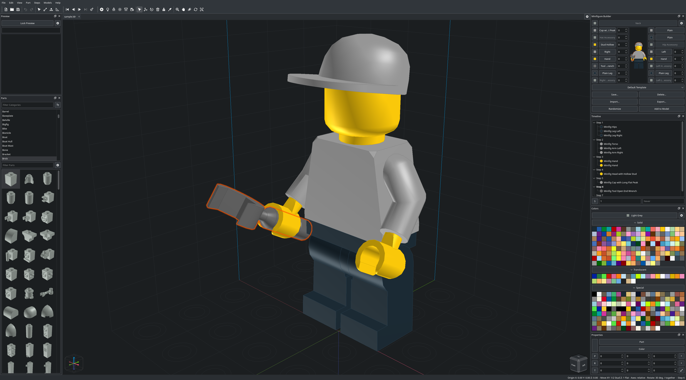

- **Menus by task.** File, Edit, View, Part, Steps, Models and Help, with clean labels and a unique mnemonic in each menu. The View menu holds the Toolbars, Viewpoints, Cutaway, Cameras, Projection and Shading submenus.
- **Options menus.** The gear button on the model view and on every panel opens the settings that belong to it: grids, preview, parts and colors.
- **Toolbars.** Standard, Tools and Time toolbars. Move and rotate cursors show the axis they work on.
- **Transform toolbar.** Type a position or rotation for the selection and apply it, as absolute coordinates or relative to where it is now.
- **Tabs, splits and status bar.** Open several models in tabs, split the view, go Full Screen, and read the view orientation, projection and focus position in the status bar. Right click the status bar to show or hide each segment.
- **Split views.** Split the current view horizontally or vertically, as often as you like, remove one view, or Reset Views back to one. Each view keeps its own camera and projection, and a border marks the active one.
- **Toolbars and panels on demand.** View > Toolbars shows or hides each toolbar and panel: Standard, Tools, Time, Parts, Colors, Properties, Timeline, Preview, Terminal and Minifigure Builder. Close Tab closes the current model tab.
- **Undo and clipboard.** Undo and Redo every change, and Cut, Copy and Paste parts between models and tabs.
- **Contextual help.** Choose Help > What's This? or click the question mark in a title bar, then click any control to read what it does. F1 explains the focused control, and every entry is listed in the Help index below.
- **Help menu.** Home Page opens the StudWorx repository on GitHub, Report a Bug its issues, and About shows the version and system information.
- **Ten languages.** English, French, German, Spanish, Portuguese, Czech, Ukrainian, Russian, Simplified Chinese and Traditional Chinese.
- **Color theme.** Follow the system, or force the light or dark theme, from Preferences.

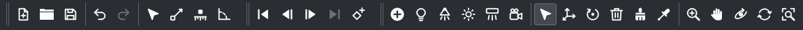

### Menus

<!-- gallery natural -->

### Submenus and options

<!-- gallery natural -->

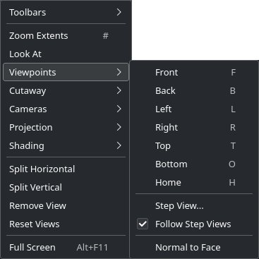
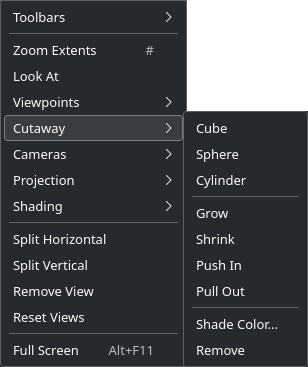

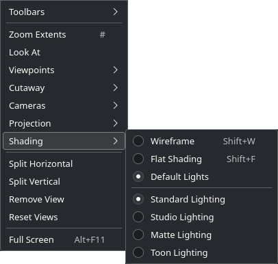
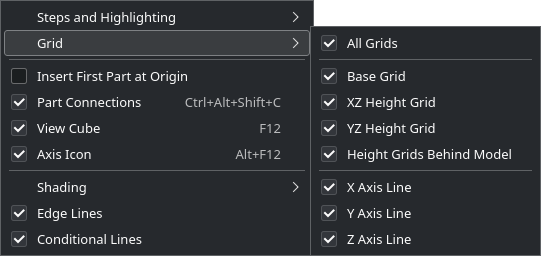

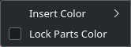
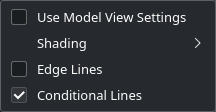

## Files

<!-- files | grey | FILES // OPEN, IMPORT, EXPORT AND PRINT -->

Models are plain LDraw text files in LeoCAD's format, so they open in either program. StudWorx reads and writes them, imports from other tools, exports to 3D and parts list formats, and prints the current view.

- **LDraw models.** .ldr, .mpd and .dat files, with New, Open, Merge, Save, Save As, Reload and the four most recent files. Watch for File Changes reloads a model edited in another program.
- **Startup.** Open Most Recent File on Startup reopens the last model, Restore Tab Layout brings back its tabs and split views, and Load All Parts Before Showing waits until every part is loaded before the model appears.
- **LeoCAD models.** Models saved by LeoCAD open as they are, and their LeoCAD meta commands are migrated to StudWorx ones, automatically when you choose so in Preferences.
- **Import.** LEGO® Digital Designer models and official set inventories. Set inventories use your own free Rebrickable API key, asked for once, and are searched by set name or number.
- **Export.** 3D Studio, COLLADA, Wavefront, KMZ, POV-Ray, HTML pages with step images, BrickLink wanted lists and CSV parts lists.
- **KMZ.** Google Earth and SketchUp models, with the visible surfaces only or every part's geometry, set in Preferences.
- **COLLADA.** Translucent colors can be marked as transparent materials for programs that read them.
- **HTML.** One page per model or one step per page with an index, step images of any width and height with an optional transparent background, and a parts list after each step or at the end, for the current model, its submodels or all models.
- **Print.** File > Print prints the current model view through the system print dialog, with a Preview button where the dialog allows it.
- **Thumbnails.** Model thumbnails in file managers, from a KDE thumbnail plugin or the desktop thumbnailer.
- **Parts library.** Downloaded on the first start as the official LDraw complete.zip, or chosen from an archive you already have, and reloaded from the File menu. An unofficial parts folder can be added beside it.
- **Command line.** Render images, transparent images with --transparent and POV-Ray renders, and import or export settings, shortcuts and categories without opening a window. See man studworx.
- **Exit.** File > Exit asks to save each changed model before StudWorx closes.

### Command line

studworx model.ldr opens a model. The options below work without opening a window, and man studworx describes each one.

| Options | What they do |
| --- | --- |
| -l, --libpath, --unofficial-library, --shadow-library | Choose the parts, unofficial parts and LDCad shadow libraries |
| -i, --image, -w, --width, -h, --height | Save an image of the model at a size |
| -f, --from, -t, --to, -s, --submodel | Save a range of steps, or one submodel |
| -c, --camera, --viewpoint, --camera-angles, --camera-position, --camera-position-ldraw | Choose a camera, a viewpoint or an exact camera position |
| --orthographic, --fov, --zplanes, --transparent | Projection, field of view, clipping planes and a transparent background |
| --fade-steps, --highlight, and their colors | Fade previous steps and highlight new parts |
| --shading, --lighting, --line-width, --aa-samples | Shading mode, lighting style, edge line width and antialiasing |
| -ss, --stud-style | One of the eight stud styles |
| -ec, -bec, -dec, -scc, -aec, -cc, -ldv | Edge, black edge, dark edge and stud cylinder colors, automated edge colors, contrast and light to dark value |
| -obj, -3ds, -dae, -kmz, -csv, -bl, -html, -pov | Export Wavefront, 3D Studio, COLLADA, KMZ, CSV, BrickLink, HTML and POV-Ray files |
| --povray-render | Render with POV-Ray |
| --import-settings, --export-settings | Settings as an ini file |
| --import-keyboard-shortcuts, --export-keyboard-shortcuts, --import-mouse-shortcuts, --export-mouse-shortcuts | Keyboard and mouse shortcuts |
| --import-categories, --export-categories | Part categories |
| -v, --version, -?, --help | Version and usage |

## Image

<!-- image | camera | SAVE MODEL IMAGE // STILLS AND ANIMATED GIFS -->

File > Image saves still images and animated GIFs of the active model. The preview on the left shows exactly what will be saved, and the settings on the right are grouped by what they change. Every setting is kept for the next time.

<!-- gallery two -->

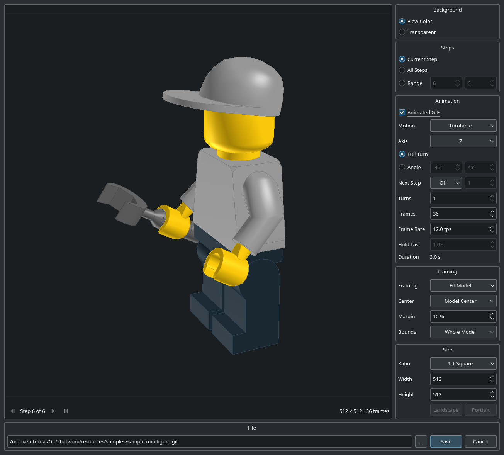

- **Background.** View Color saves the view background opaque. Transparent leaves it empty so the model can be placed over other images. Only PNG and GIF files keep transparency.
- **Steps.** Current Step, All Steps or a Range. Saving several still steps writes one numbered file per step: model.png becomes model01.png, model02.png and so on. The arrows under the preview look through the steps first.
- **Framing.** Current View saves what the model view shows. Fit Model moves the camera back until every part fits, at every turntable angle. Fit Each Step fits every step on its own parts. Margin keeps 0 to 50 percent of empty space around the model.
- **Center and Bounds.** Turntables turn around the World Origin, the Model Origin or the Model Center. Bounds measures the fit on the Whole Model, so every step lines up, or on the Shown Steps only.
- **Size.** Ratio presets from 1:1 Square through 5:4, 4:3, 3:2 and 16:10 to 16:9 and 21:9, Free, or the shape of the View. Width and Height go up to 32768 pixels, in Landscape or Portrait.
- **File.** Type the path or choose it with the ... button. The extension sets the format: .png, .jpg, .bmp, or .gif for animations. Turning Animated GIF on or off switches the extension for you.

### Animated GIF

Check Animated GIF to save one looping GIF. The preview plays it live with a play and pause button, and Motion chooses what moves.

| Setting | Turntable | Steps |
| --- | --- | --- |
| Axis, Full Turn, Angle | used | off |
| Next Step | Off, Turns or Seconds | off |
| Turns | revolutions or swings per loop | off |
| Frames | per turn, 2 to 360 | one per step, read only |
| Frame Rate | 0.5 to 50 fps | 0.5 to 50 fps |
| Hold Last | with Next Step on | used |
| Duration | read only | read only |

- **Turntable.** The model turns around the X, Y or Z axis through the Framing center. Full Turn makes seamless revolutions, Angle swings between two angles, measured from the current view, and back. Turns sets 1 to 10 revolutions per loop, Frames the images in one turn, Frame Rate how many are shown each second. Fit Model keeps one steady zoom through the whole turn.
- **Steps.** Each chosen step becomes one frame, without turning, for short animated instructions. At 2 fps every step shows for half a second.
- **Next Step.** The model keeps turning while the build moves on every 1 to 10 Turns or every 0.1 to 60 Seconds, through the chosen steps, and the loop ends on the last one. Turns then shows the total, steps × turns per step. Frames stay per turn, so the turning speed is the same however many steps there are.
- **Hold Last.** Keeps the finished model on screen for 0 to 10 seconds before a loop through the steps restarts.
- **Duration.** Shows how long one loop plays: turns × frames ÷ frame rate for a turntable, steps ÷ frame rate + hold for steps, and the frames of every step ÷ frame rate + hold with Next Step. Six steps, one turn each, at 24 frames per turn and 12 fps with a one second hold make 144 frames playing for 13 seconds.

<!-- gallery two -->

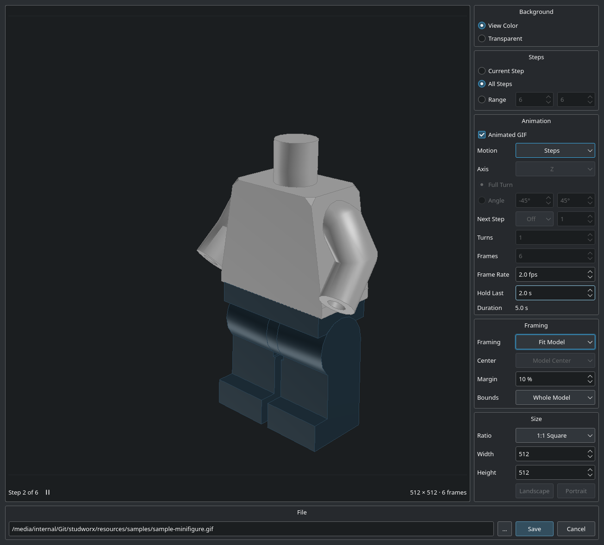

<!-- gallery three square -->

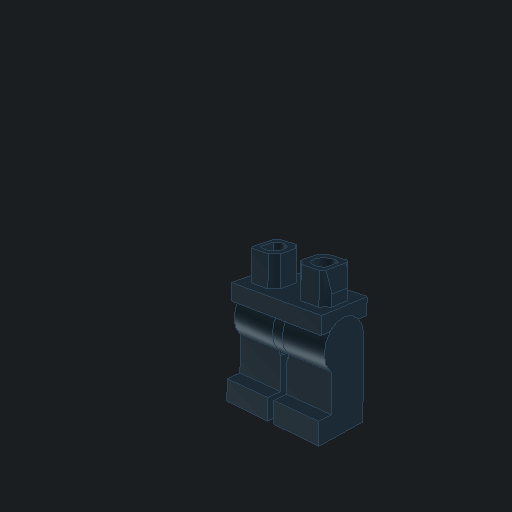

### Settings and command line

The dialog keeps its settings in the [Settings] group of ~/.config/StudWorx/StudWorx.conf, saved when you click Save. Still images can also be saved without opening a window with --image and the options in man studworx, including --transparent; animations are saved from the dialog.

| Key | Setting |
| --- | --- |
| ImageWidth, ImageHeight, ImageRatio | Size |
| ImageExtension | File format |
| ImageSteps, ImageTransparent | Steps and Background |
| ImageMotion, ImageAxis, ImageFullTurn, ImageAngleStart, ImageAngleEnd | Motion and turn |
| ImageTurns, ImageFrames, ImageFrameRate | Turns, Frames, Frame Rate |
| ImageNextStep, ImageNextStepTurns, ImageNextStepSeconds | Next Step |
| ImageHoldLast | Hold Last |
| ImageFit, ImageCenter, ImageMargin, ImageFitScope | Framing |

## Rendering

<!-- rendering | details | RENDERING // LIGHTING, SHADING AND RENDERERS -->

The model view draws fast with OpenGL in four lighting styles, and File > Render hands the model to POV-Ray or Blender for photo quality images.

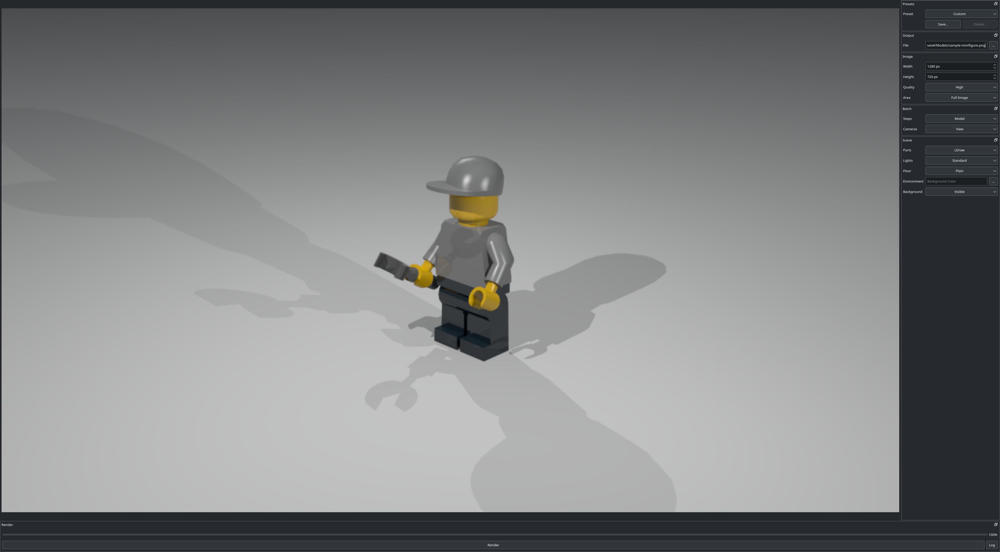

- **POV-Ray.** Found on its own in the PATH, Flatpak or Snap and checked for version 3.7. LGEO high detail parts are found beside the parts library or downloaded on request, with a Parts choice between LDraw and LGEO.
- **Render window.** Choose the output file, follow the progress, and watch the image appear in the preview as it renders.
- **Blender.** Render with the Blender LDraw add-on, or Open in Blender to keep working on the scene there. The add-on settings live in Preferences.
- **Lighting styles.** Standard, Studio, Matte and Toon, from the View menu or the command line with --lighting. Standard uses one light with soft highlights, Studio key, fill and rim lights, Matte no highlights, and Toon banded cel shading.
- **Shading.** Wireframe, flat shading, default lights, edge lines, conditional lines and mesh level of detail.
- **Mesh level of detail.** Distant parts draw with simpler meshes, from a distance set in Preferences, so large models stay smooth.
- **Studs.** Eight stud styles: Plain, Thin Lines Logo, Outline Logo, Sharp Top Logo, Rounded Top Logo, Flattened Logo, High Contrast and High Contrast with Logo.
- **Edge colors.** Automate Edge Color computes edge colors from each part color, with edge contrast, saturation and light to dark settings, or set the stud cylinder, edge, black edge and dark edge colors yourself.
- **Separate settings.** The model view, the preview, the parts list and the Minifigure Builder each keep their own rendering settings. Each can follow the model view instead, or set its own wireframe, flat shading, default lights, edge lines, conditional lines and line width.
- **Selection highlight.** Outline or tint and edges, with an adjustable outline width and transparency.
- **Antialiasing.** 2x, 4x or 8x samples, and an adjustable line width.

<!-- gallery four -->

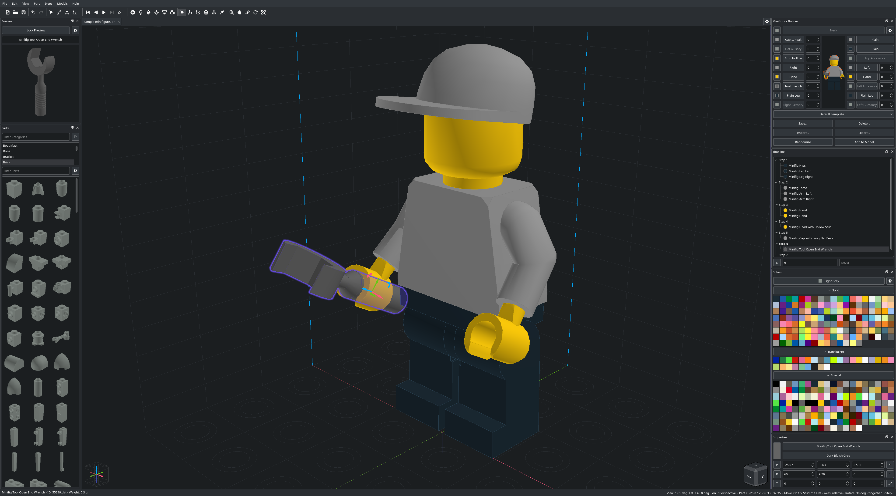
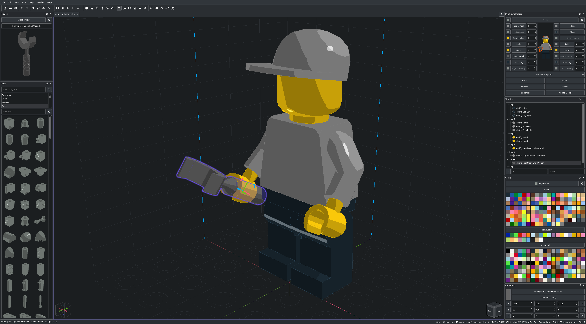

## Modeling

<!-- modeling | color | MODELING // PARTS, SELECTION AND TRANSFORMS -->

Pick a part in the Parts panel, drop it in the model view, then move, rotate, paint and group it. Snapping keeps everything on the LDraw grid, and selection tools find the parts you need in large models.

- **Parts.** Insert, delete, duplicate, paint, hide and group parts, with the first part placed at the origin as an option.
- **Insert colors.** Insert with the current color, the selected part's color or the last inserted color, or lock the Parts panel to one color.
- **Snapping.** Move in studs, flats and bricks, rotate in degrees with a custom angle, with relative or absolute transforms and separate or shared rotation.
- **Move snap.** Horizontal steps of 1/20 stud, 1/4 stud, 1 flat, 1/2 stud and 1, 2, 3, 4 or 8 studs, vertical steps of 1/20 stud, 1/4 stud, 1 flat, 1/2 stud, 1 stud and 1, 2, 4 or 8 bricks, or None.
- **Rotation snap.** 1, 5, 15, 22.5, 30, 45, 60, 90 or 180 degrees, a custom angle, or None. Camera Snap orbits the view in the same steps.
- **Transforms.** Relative Transforms move and rotate the selection around the part that has focus, Absolute Transforms in model coordinates. Rotate Separately turns each part around its own pivot, Rotate Together turns the selection as one. Each pair has a toggle shortcut.
- **Keyboard moves.** Move and rotate the selection along +X, -X, +Y, -Y, +Z and -Z by the snap steps. Fixed Direction Keys keeps the arrow keys on the model axes instead of following the view.
- **Selection.** Select All, None, Invert, Adjacent Parts, by Name, and by part, color or both. Select Connected Parts follows the connection shapes of the LDCad shadow library.
- **Selection modes.** Single Selection picks one part, Part Selection every part of the same type, Color Selection every part of the same color, and Part and Color Selection both.
- **Select by Name.** A checklist of every object in the model, with All, None and Invert.
- **Part connections.** Use Part Connections turns connected part selection on and off, with the shadow library folder chosen in Preferences.
- **Find and Replace.** A bar to find parts by part and color, step through the matches or Find All, and replace one or all, submodels included on request.
- **Array.** Repeat the selection along one, two or three axes, with an offset and a rotation for each.
- **Flex Path.** Hoses, cables and other flexible parts bend along control points that stop at the part length.
- **Control points.** Insert and remove control points, clamp a point along the path or release it to rotate freely, align it to the path once, or turn it along the X, Y or Z axis. New points can start clamped, and the spread handle shapes the curve.
- **Groups.** Group the selection under a unique name, Ungroup, add the focused part to a group or remove it, and Edit Groups in a tree of parts and groups.
- **Hide and show.** Hide Selected or Hide Unselected, then Unhide Selected or Unhide All.
- **Show Earlier and Later.** Move the selected parts one step earlier or later.
- **Train track.** Rotate Train Track turns a track piece to its next connection, and Focus Next and Previous Connection choose where the next piece joins.
- **Pivot points and keyframes.** Reset Pivot Point puts the pivot back at each part's origin, and Remove Keyframes clears the animation of the selected parts.
- **Lights and cameras.** Lights and cameras are placed in the model and saved with it, see Tools.

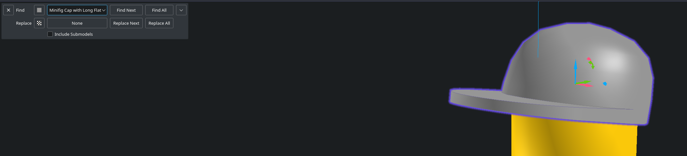

<!-- video -->

[A Flex Path hose follows its end point as it moves, then seats back on its brick](resources/videos/studworx-flex-01.mp4)

<!-- video -->

[A hose end seated on a newly placed brick, the path bending to reach it](resources/videos/studworx-flex-02.mp4)

<!-- video -->

[A hose seated on the side of a brick, following it as the bricks move](resources/videos/studworx-flex-03.mp4)

## Tools

<!-- tools | red | TOOLS // MOUSE, LIGHTS AND CAMERAS -->

The Tools toolbar sets what the mouse does in the model view. Every tool has a keyboard shortcut, and mouse buttons with modifier keys can start any tool for one drag.

- **Edit tools.** Insert adds the part chosen in the Parts panel, Select picks objects, with Ctrl or a drag for several, Move and Rotate change the selection, Delete removes what you click, Paint colors a part, and Color Picker takes a part's color.
- **View tools.** Zoom, Pan, Rotate View and Roll change the camera, and Zoom Region zooms into a rectangle you drag.
- **Keyboard view.** Zoom In and Zoom Out, and Move Forward, Backward, Left, Right, Up and Down.
- **Lights.** Point Light, Spotlight, Directional Light and Area Light tools place lights in the model, with named properties and units, saved in the model file.
- **Cameras.** The Camera tool places a camera. View > Cameras switches between the first sixteen cameras, or None for the free view.
- **Cancel Action.** Esc cancels the current mouse action, and with nothing selected removes the cutaway.
- **Mouse.** Mouse sensitivity and a shortcut for every tool and view action, recorded in Preferences.

## Views

<!-- views | plane | VIEWS // CUBE, CAMERAS, CUTAWAYS AND GRIDS -->

Look at a model from any side, see inside it without changing it, and measure it against the grid.

- **View cube.** Chamfered edges and corners: click any of its 6 faces, 12 edges or 8 corners for that view.
- **View cube settings.** Shown in any corner of the view, in Extra Small to Extra Large, with its own face, highlight and text colors.
- **Axis icon.** X, Y and Z labels with optional negative axes. The view cube, axis icon and part thumbnails come in Extra Small to Extra Large.
- **Axis icon settings.** Shown in any corner, with or without labels, with negative axes and a cube outline of adjustable transparency, and a color for each axis and its negative.
- **Preview overlays.** The preview shows its own view cube and axis icon, each turned on and off from its options.
- **Viewpoints.** Front, Back, Top, Bottom, Left, Right and Home, Zoom Extents, Look At and Normal to Face.
- **Projection.** Perspective or orthographic, for the active view or all views at once.
- **Cameras.** A floating camera bar, camera orbit snapping and cameras numbered Camera 001.
- **Cutaways.** Cube, sphere and cylinder cutaways with solid cut surfaces, a shaded cut and resize knobs, pushed in or pulled out by one plate. The model is never changed.
- **Cutaway controls.** Grow and Shrink resize the cutaway, Push In and Pull Out move it one plate, Shade Color sets the light shade on the cut faces, and Remove shows the whole model again.
- **Grids.** A base grid with studs, lines and origin lines, vertical XZ and YZ height grids sized around the model, and a toggle for each axis line.
- **Grid settings.** Line spacing, stud and line colors, and Height Grids Behind Model to keep the height grids behind the parts.
- **Idle turntable.** The model turns full screen around the X, Y or Z axis when you leave StudWorx idle. Any input ends it. The idle time and the time for one turn are set in Preferences.

<!-- gallery cube -->

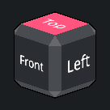
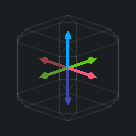

<!-- gallery three -->

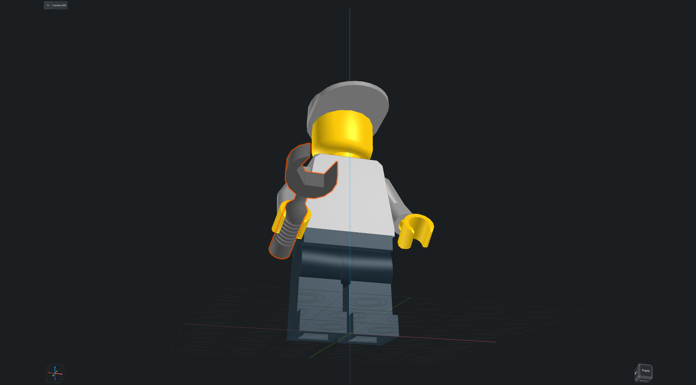

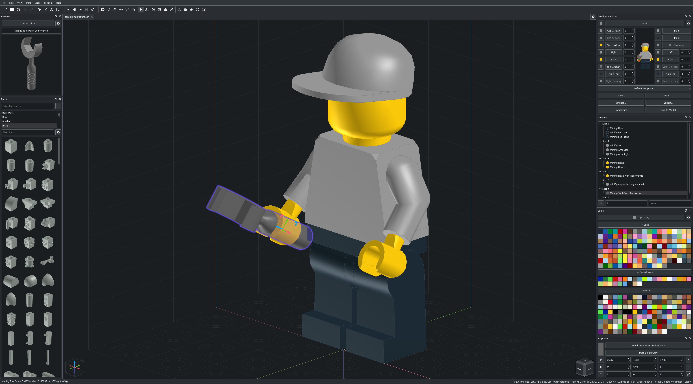
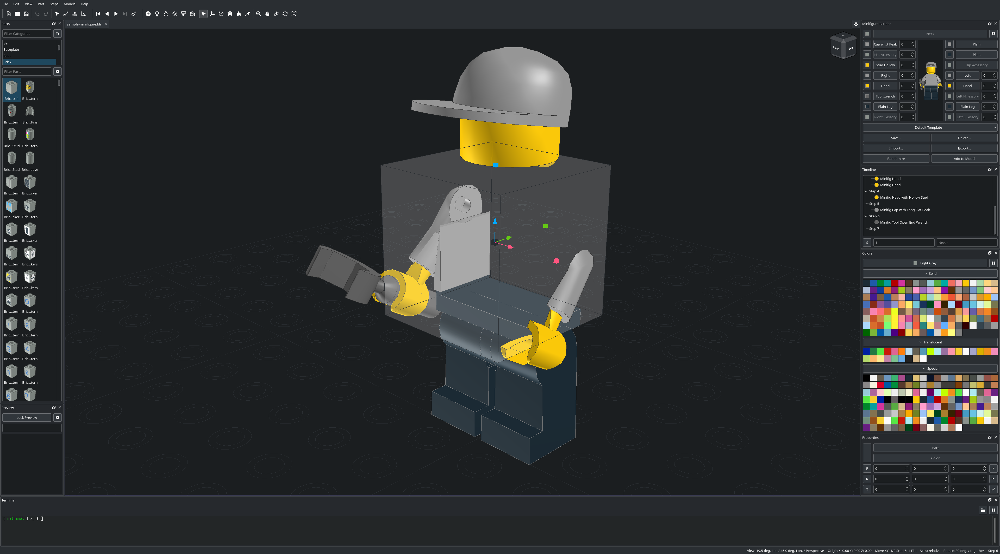

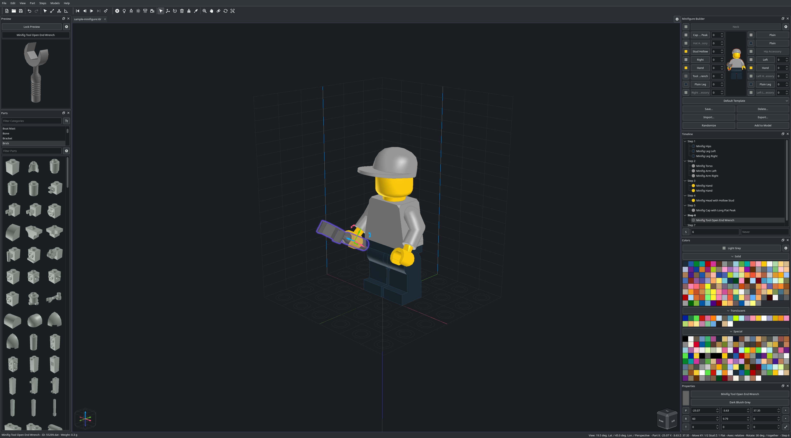

## Steps

<!-- steps | yellow | STEPS // BUILD ORDER AND TIMELINE -->

Every part belongs to a building step. Steps drive the model view, the instructions and the animated GIFs.

- **Steps menu.** Go to the first, previous, next or last step, and insert or remove steps.
- **Timeline.** Shows the step each part is added in and removed in. An empty removal step reads Never. Drag parts between steps or reorder them.
- **Move and paste.** Move the selection to the current, previous or next step, and paste with its steps.
- **Step views.** MLCad ROTSTEP step views are shown, edited and followed in the Timeline.
- **Step view commands.** Step View sets the view rotation of the current step, Remove Step View clears it, and Follow Step Views turns the view to each step's rotation as you change steps.
- **Emphasis.** Fade Previous Steps and Highlight New Parts in the model view and the instructions, with a color for each.
- **Animation keys.** Add Keys records new animation keys for parts, lights and cameras as you change them.

<!-- gallery natural -->

## Panels

<!-- panels | wireframe | PANELS // PARTS, COLORS, PROPERTIES AND MORE -->

Panels dock side by side in any area of the main window, with uniform headers, buttons and text boxes sized from their options button.

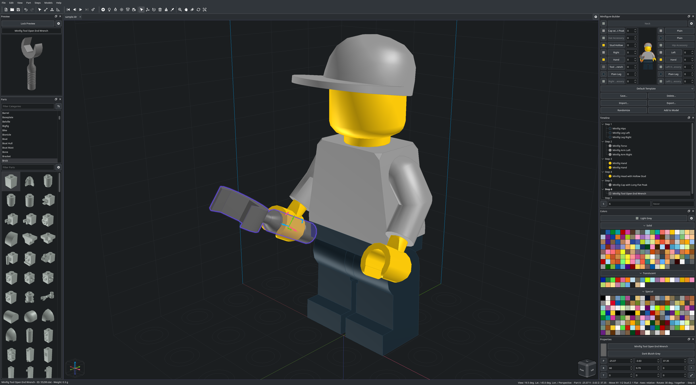

- **Parts.** Categories and palettes with a filter. The panel snaps to whole thumbnail tiles and rows, docked or floating.
- **Part palettes.** Create, rename, reorder and delete palettes, import them, or build one from an online set inventory.
- **Colors.** Collapsible solid, translucent and special color groups with square color tiles.
- **Properties.** Compact position, rotation and transform rows and a spanning color swatch. Lights and cameras get named rows with units.
- **Minifigure Builder.** Build a minifigure from templates and add several variations to the model.
- **Preview.** Parts and models in a square viewport, with Keep Last Selection.
- **Terminal.** An embedded terminal sized to whole rows and columns, with Open Model Folder.
- **Terminal folders.** Follow Model Folder moves the terminal to the folder of each model you open, and Go to Model Folder moves it there once.

<!-- gallery natural -->

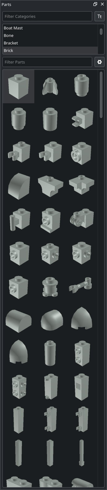

## Instructions

<!-- instructions | blue | INSTRUCTIONS // PAGES READY TO PRINT -->

File > Instructions lays the steps out on pages with a cover, parts lists and a bill of materials. Every page element can be styled and placed, and everything is saved in the model file as !SW INSTRUCTION meta commands.

<!-- gallery three -->

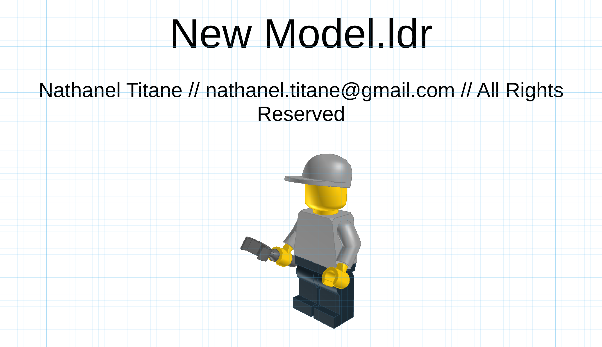
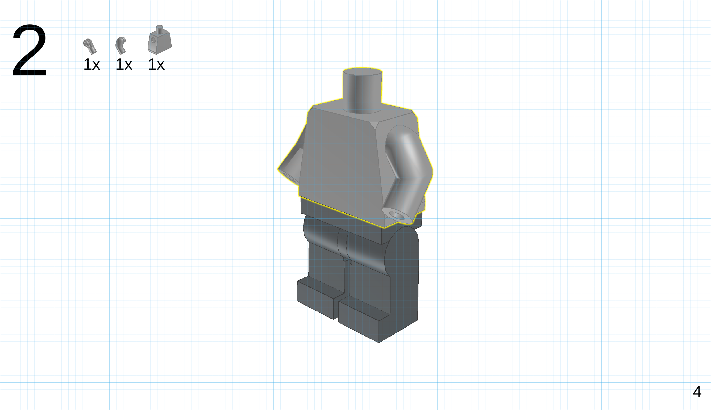
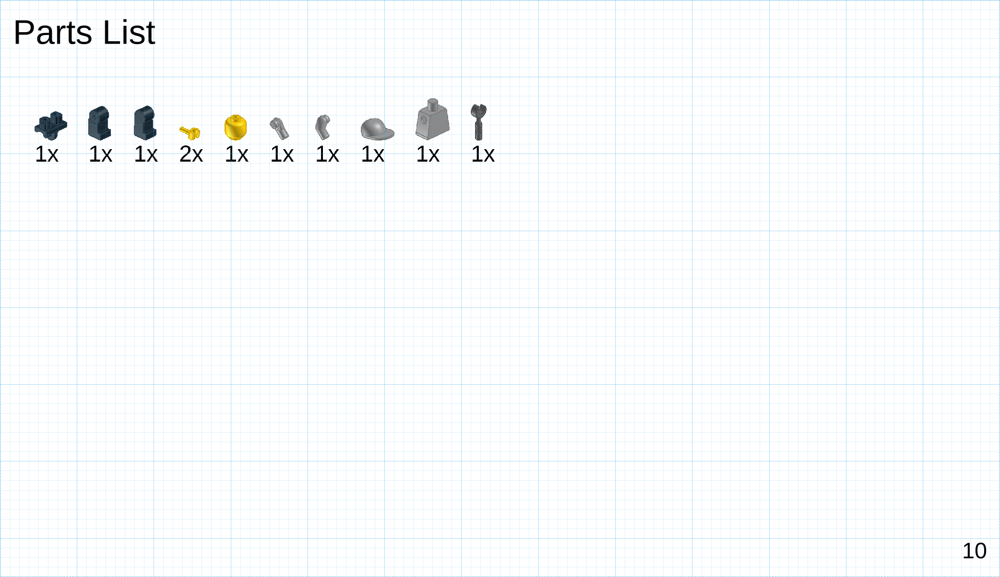

- **Page setup.** Paper and screen presets, metric or imperial units, margins and orientation.
- **Pages.** A cover page, a bill of materials, blank page breaks and the steps per page, set for each page.
- **Style.** Step dividers, the document font, the model projection, parts list counts, sort order and border, and full page backgrounds.
- **Step images.** Parts new to each step are outlined and the earlier ones fade.
- **Placement.** Place, drag and lock every page element within the page margins, on a snapping page grid.
- **Elements.** Page numbers, colors, fonts, padding, margin, border and background for every page element, plus notices and pointers to emphasize parts and steps.
- **Print and Editor.** A built-in Print panel, and an Editor panel to read and edit the model file text.

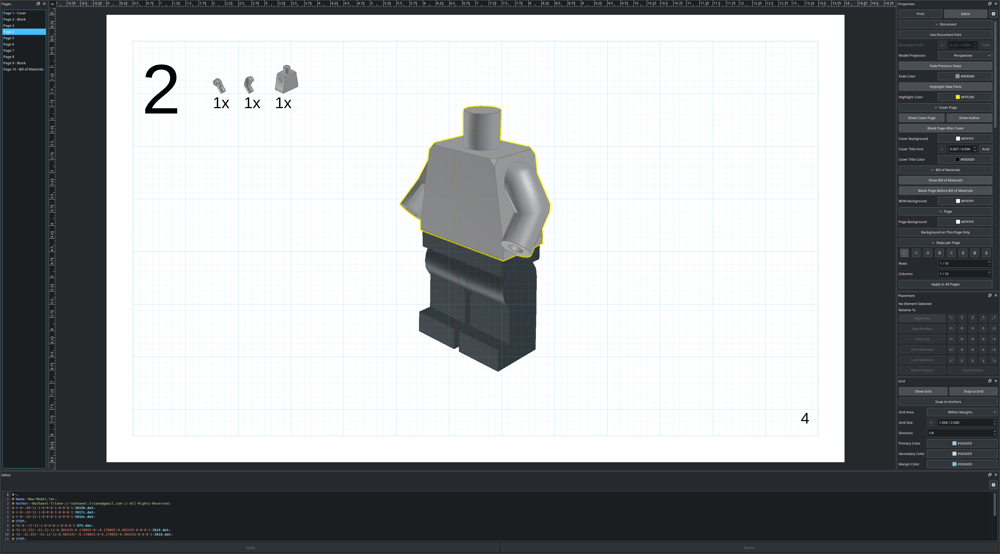

<!-- gallery natural -->

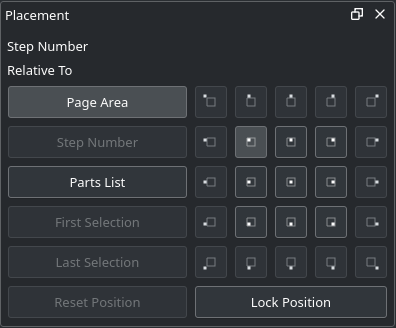
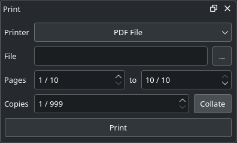

## Models

<!-- models | green | MODELS // SUBMODELS AND PROPERTIES -->

Large builds split into submodels that you can edit on their own or in place, inside the model that uses them.

- **Properties.** Part IDs, thumbnails and counts, with BrickLink or CSV export.
- **Submodels.** New Submodel, the Submodels list, Open Selected Model, Inline Selected Models and Move to New Model.
- **Submodels list.** Create, rename, duplicate and delete submodels, set the active one, and export them as separate LDraw files.
- **Models menu.** Switch between up to forty models of the file from the Models menu.
- **In-place editing.** Edit a submodel inside its parent. A path bar shows where you are, and its buttons go back to each model.
- **Editing commands.** Edit Selected Submodel enters the selected submodel in place, and End Submodel Editing goes back to its parent.
- **Names.** Consistent default names and numbered duplicates: Submodel 001.ldr, and Car.ldr becomes Car 001.ldr.

<!-- gallery three -->

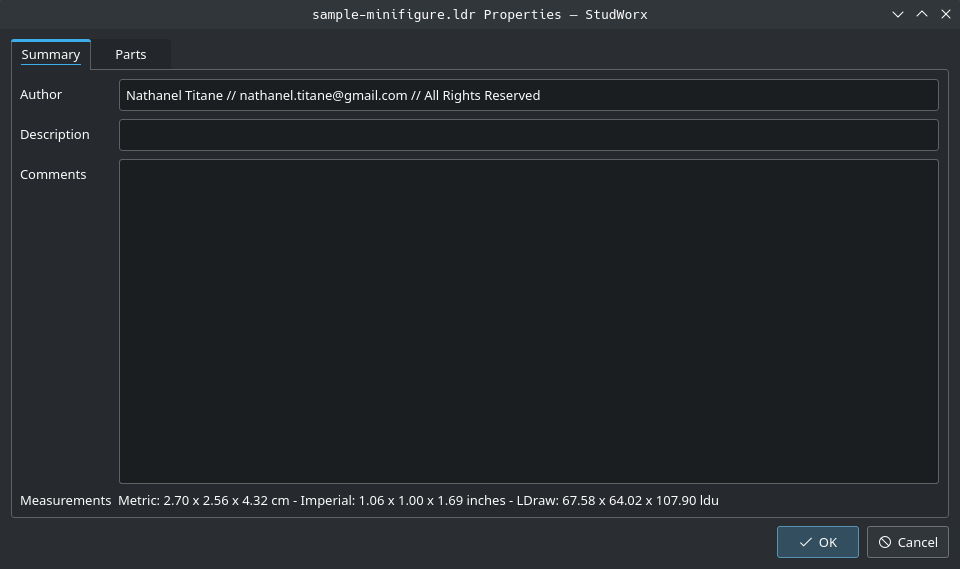
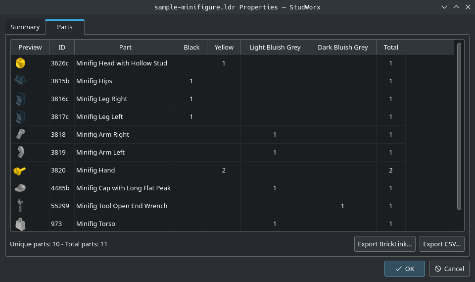
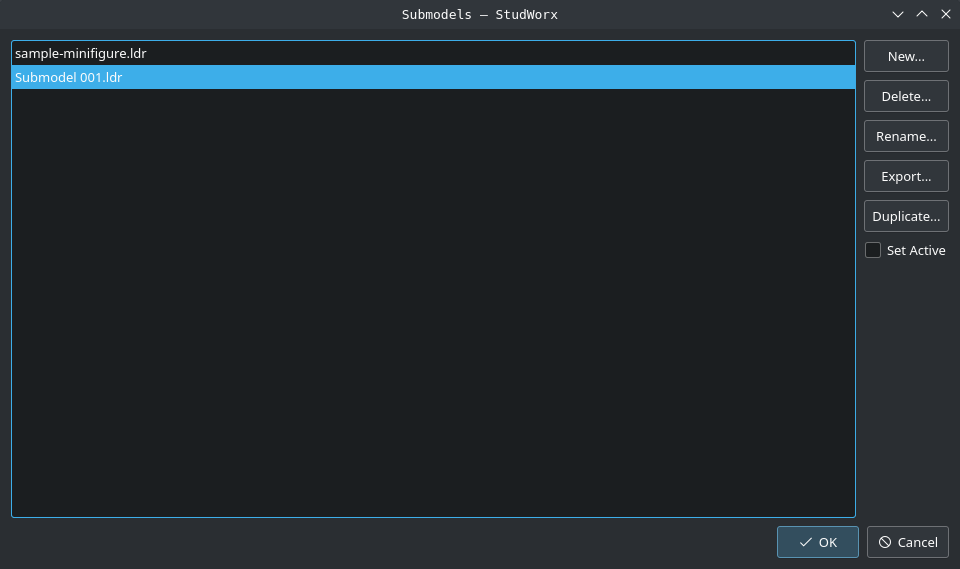

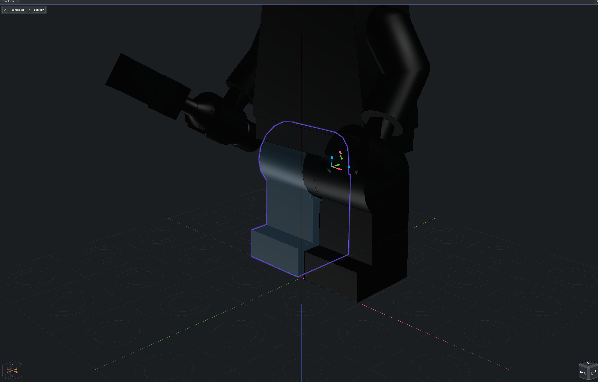

## Preferences

<!-- preferences | grid | PREFERENCES // EVERY SETTING IN ONE PLACE -->

Eight pages with lined up label and control columns. Value boxes show their maximum and bring any typed number into range, and every slider shows its value.

- **General.** Reference paths, the author of new models, and the parts library, LGEO and POV-Ray locations.
- **Startup and files.** Open the most recent file, restore the tab layout, load all parts before showing a model, watch for file changes and migrate LeoCAD models automatically.
- **Rendering and Views.** Rendering quality, the Blender add-on settings, and the Model, Cutaway, Turntable, Base Grid, Parts, Preview and Minifigure Builder groups.
- **Colors and Instructions.** Interface and view colors, edge contrast, and the default instruction page settings.
- **View colors.** Background, active and inactive view borders, selected, focused and new parts, the marquee, overlays, text and its halo, lights, cameras, control points, flex paths, the view cube and every axis.
- **Categories.** Part categories turned on and off with a checkbox, edited, imported and exported.
- **Keyboard and Mouse.** Shortcuts recorded by clicking, importable and exportable.
- **Shortcut filters.** Filter commands and tools by name or shortcut, give each two shortcuts, and reset them to the defaults.
- **From LeoCAD.** Settings, part palettes and minifigure templates are copied from LeoCAD on the first start.

<!-- gallery four tall -->

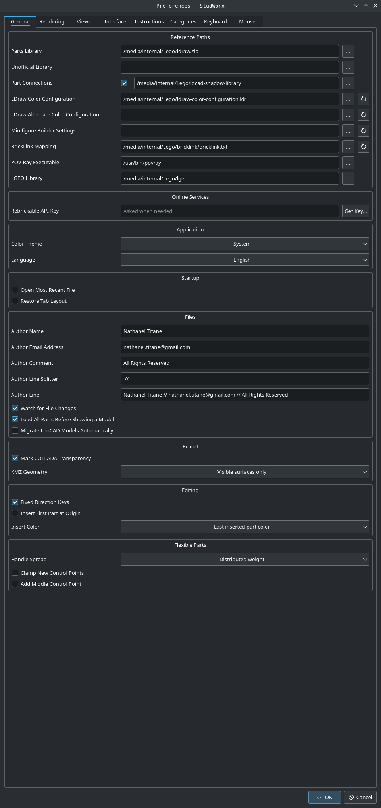
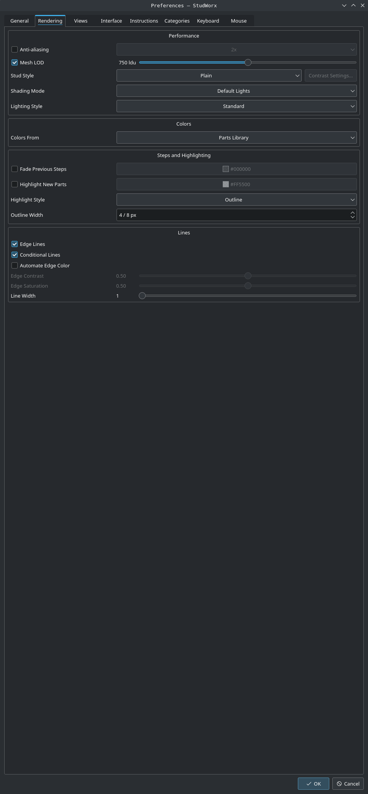
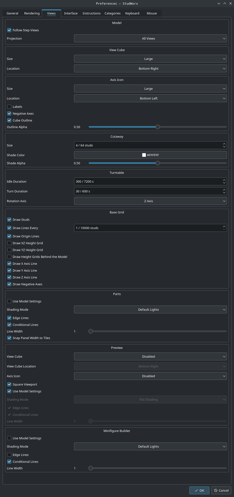
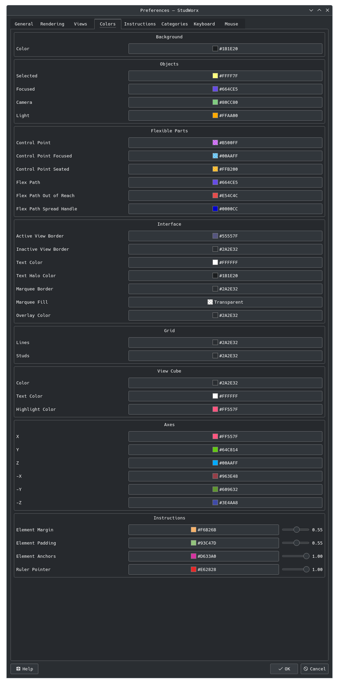
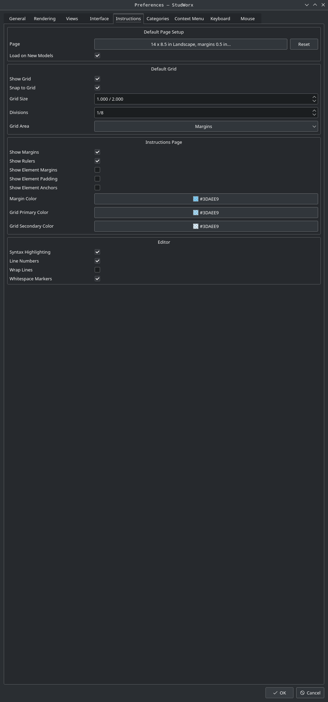

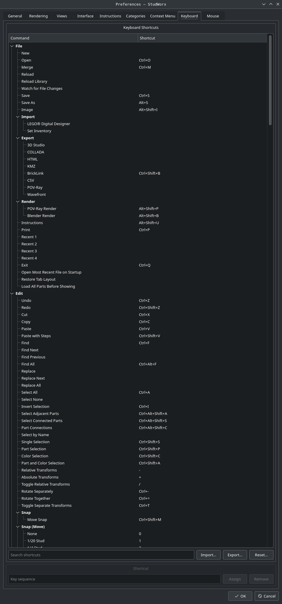
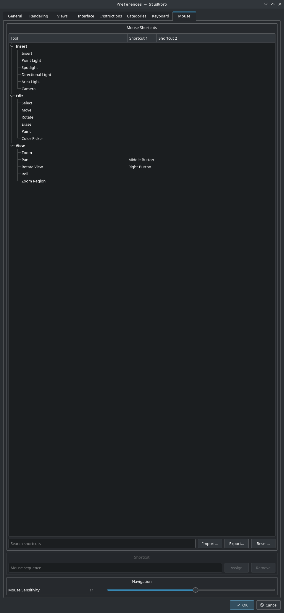

<!-- gallery natural -->

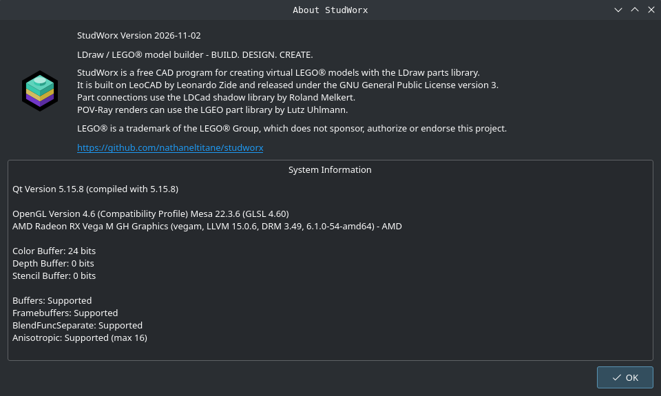
