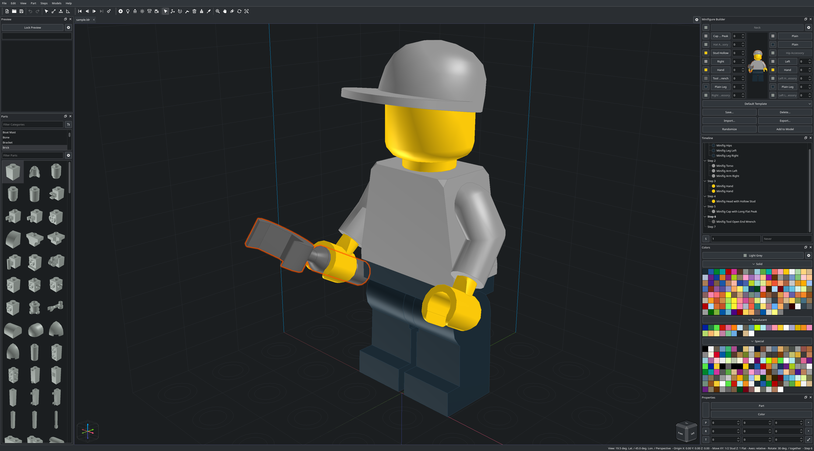

<p align="center"><br><b>LDraw / LEGO® model builder</b><br>BUILD. DESIGN. CREATE.</p>

---

[](https://www.paypal.com/donate?hosted_button_id=ZW3CDCANHJCWJ)<br>
Show your appreciation with a PayPal donation!

---

[](https://github.com/nathaneltitane/studworx)<br>
Useful? Star the repository - it helps others find it.

---

### Welcome to [StudWorx](https://studworx.app)

StudWorx is a free LDraw / LEGO® model builder, a CAD program for creating virtual LEGO® models with the [LDraw](https://www.ldraw.org) parts library, built on [LeoCAD](https://github.com/leozide/leocad).
It keeps LeoCAD's file format, so models open in either program, and copies LeoCAD's settings on the first start.

Every feature, menu and panel is listed in [SITE.md](SITE.md) and shown on [studworx.app](https://studworx.app) - release notes are listed in [NOTICE.md](NOTICE.md).



---

### TL;DR

**Install ↴**

Download the Debian, Ubuntu, Fedora, openSUSE, AppImage, Windows or macOS package from the [latest release](https://github.com/nathaneltitane/studworx/releases/latest).

**Build ↴**

Install the build requirements - a C++ compiler, Qt 5 and zlib development packages:

Debian, Ubuntu:

```
sudo apt install g++ make qtbase5-dev qttools5-dev-tools libqt5opengl5-dev libqt5svg5 qt5-image-formats-plugins zlib1g-dev
```

Fedora, Rocky Linux, RHEL:

```
sudo dnf install gcc-c++ make qt5-qtbase-devel qt5-linguist qt5-qtsvg qt5-qtimageformats zlib-devel
```

openSUSE:

```
sudo zypper install gcc-c++ make libqt5-qtbase-devel libqt5-linguist libqt5-qtsvg libqt5-qtimageformats zlib-devel
```

Arch Linux:

```
sudo pacman -S base-devel qt5-base qt5-tools qt5-svg qt5-imageformats zlib
```

Optional - gamepad input, the terminal panel with KParts and a KDE Frameworks 5 Konsole, and file manager thumbnails with KIO:

Debian, Ubuntu:

```
sudo apt install libqt5gamepad5-dev libkf5parts-dev libkf5kio-dev
```

Fedora, Rocky Linux, RHEL:

```
sudo dnf install qt5-qtgamepad-devel kf5-kparts-devel kf5-kio-devel
```

openSUSE:

```
sudo zypper install kparts-devel kio-devel
```

Arch Linux:

```
sudo pacman -S qt5-gamepad kparts5 kio5
```

Build and install without a package - a prefix and a build directory can follow the install command, the prefix defaults to '/usr/local', '~/.local' needs no superuser rights:

```
git clone https://github.com/nathaneltitane/studworx
studworx/tools/studworx-install
```

**Run ↴**

Start StudWorx and let it download the [LDraw parts library](https://library.ldraw.org/updates?latest) on the first start.

---

### Credits:

StudWorx is based on [LeoCAD](https://github.com/leozide/leocad) by Leonardo Zide and its contributors - see [CREDITS](CREDITS.md).

Part connections come from the [LDCad shadow library](https://github.com/RolandMelkert/LDCadShadowLibrary) by Roland Melkert, made for [LDCad](https://www.melkert.net/LDCad) and released under the Creative Commons Attribution-ShareAlike 4.0 license - it is not bundled with StudWorx.

POV-Ray renders can use the [LGEO library](https://github.com/jncraton/lgeo) by Lutz Uhlmann, high detail LEGO® part models for POV-Ray that may be redistributed freely - it is not bundled with StudWorx.

### License:

StudWorx is free software released under the GNU General Public License version 3 - see 'LICENSE.md'.

LEGO® is a trademark of the LEGO® Group, which does not sponsor, authorize or endorse this project.

### Reports:

[Submit bug report or feature request](https://github.com/nathaneltitane/studworx/issues)

### Projects:

[](https://github.com/nathaneltitane/dextop)

[](https://github.com/nathaneltitane/frobulator)

[](https://github.com/nathaneltitane/l2cu)

[](https://github.com/nathaneltitane/terminal)

[](https://github.com/nathaneltitane/mechablocks)

[](https://github.com/nathaneltitane/studworx)

[](https://github.com/nathaneltitane/nathaneltitane)

[](https://github.com/nathaneltitane/pewpewprints)

---

[](https://www.paypal.com/donate?hosted_button_id=ZW3CDCANHJCWJ)<br>
Show your appreciation with a PayPal donation!

---

[](https://github.com/nathaneltitane/studworx)<br>
Useful? Star the repository - it helps others find it.
