# Site

Every section of [studworx.app](https://studworx.app), features first. `tools/studworx-site` builds the page from this file. Each `##` section starts with a comment that sets its page id, icon and heading, and its first paragraph is the lead. A `<!-- gallery class -->` comment turns the images and video links below it into one gallery, and the title of a single image sets its figure class. A `<!-- video -->` comment turns the link below it into a looping video, with the link text as its caption. A `<!-- include name -->` comment places generated content: the meta command list, the command index, the help search or the latest notices. A paragraph made of a single link ending in › becomes a more link, and `@VERSION@`, `@COMMANDS@` and `@ENTRIES@` are filled with the release version, the command count and the help entry count.

## Interface

<!-- interface | console | INTERFACE // MENUS, PANELS AND HELP -->

StudWorx is built from standard Qt widgets: panels, dialogs and windows follow your system style and light or dark theme, and only the model views draw with OpenGL. Menus are grouped by task, every icon and cursor is drawn in code so it stays sharp at any size, and every dialog and panel explains itself.

- **Menus by task.** Every command sits in a menu named for what you're doing, like File, Edit, View, Part, Steps or Models. Each one has its own keyboard letter. The Where Is It section below finds any command.
- **Options menus.** Each panel and view has a gear button with the settings that belong to it, right where you need them.
- **Tabs, splits and status bar.** Work on several models at once in tabs, split the view to see a model from two sides, or go full screen. The status bar shows what is selected, with its name, ID and weight, the view and snap settings and the current step; right click it to choose what it shows.
- **Split views.** Split the model view into several views, each with its own camera, to see the model from different sides at once.
- **Toolbars and panels on demand.** Show only the toolbars and panels you need, and hide the rest, from View > Toolbars.
- **Lock Interface.** Keeps panels and toolbars where they are, so nothing gets dragged away by accident, and hides panel title bars to save space. Panels still resize and can still be shown or hidden. Turn it on at the end of View > Toolbars, or with a right click on any toolbar or panel title.
- **Undo and clipboard.** Undo and Redo every change, and Cut, Copy and Paste parts between models and tabs. Paste with Steps keeps the steps of the copied parts.
- **Contextual help.** Click Help > "What's This?" or the question mark in a title bar, then click anything to learn what it does. F1 works too. Every entry is also in the Help section below.
- **Help menu.** Home Page opens the StudWorx repository on GitHub, Report a Bug its issues, and About shows the version and system information.
- **Ten languages.** English, French, German, Spanish, Portuguese, Czech, Ukrainian, Russian, Simplified Chinese and Traditional Chinese.
- **Color theme.** Follow the system, or force the light or dark theme, from Preferences.

<!-- gallery scroll -->


## Toolbars

<!-- toolbars | red | TOOLBARS // STANDARD, TOOLS AND TIME -->

Toolbars hold the controls you reach for most, the same whatever you are working on. Show or hide each one from View > Toolbars or a right click on any toolbar, drag one by its handle to dock it on another edge or float it, and Lock Interface keeps them where they are.

- **Standard.** The everyday buttons, like New, Open, Save, Undo and Redo, plus four drop-downs that set how parts move and turn.
- **Tools.** Choose what the mouse does in the model view: add parts, lights or cameras, select, move, turn, paint or erase them, or look around. It starts hidden; turn it on from View > Toolbars.
- **Time.** Play through the building steps, and set or remove animation keys.
- **Transform.** Type a position or rotation for the selection and apply it, as absolute coordinates or relative to where it is now. It has no entry of its own: its fields sit at the bottom of the Properties panel, shown with View > Toolbars > Properties Panel.

<!-- gallery scroll -->

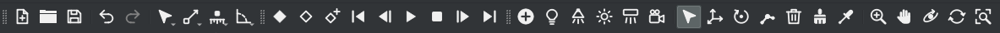
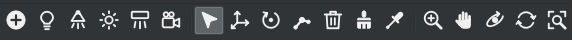

## Files

<!-- files | grey | FILES // OPEN, IMPORT, EXPORT AND PRINT -->

Models are plain LDraw text files in LeoCAD's format, so they open in either program. StudWorx reads and writes them, imports from other tools, exports to 3D and parts list formats, and prints the current view.

<!-- gallery one -->


- **LDraw models.** StudWorx opens and saves the standard LDraw files, .ldr, .mpd and .dat, as the LDraw specification describes them, keeping their line endings, and reloads a model changed in another program. Bundled samples cover every feature, from cutaways and flexible parts to joints, lights and train track.
- **Startup.** StudWorx can reopen your last model, with its tabs and views, when it starts.
- **LeoCAD models.** Models saved by LeoCAD open as they are, and their LeoCAD meta commands are migrated to StudWorx ones, automatically when you choose so in Preferences. Older LeoCAD projects (.lcd) open and merge too, and save as LDraw.
- **Import.** Open LEGO® Digital Designer models like any other file, or bring in an official set by its name or number from Rebrickable, with your own free API key.
- **Export.** Send a model to other 3D programs, POV-Ray or the web, or turn its parts into a BrickLink wanted list or a CSV parts list. BrickLink exports translate part numbers and colors through a bundled mapping of over 55,000 parts, and parts you set by hand are remembered.
- **KMZ.** Google Earth and SketchUp models, with the visible surfaces only or every part's geometry, set in Preferences.
- **COLLADA.** Translucent colors can be marked as transparent materials for programs that read them.
- **HTML.** Export HTML turns the instructions into web pages, either one long page, saved at twice its size so it stays sharp on high density screens, or one page per step, in light or dark colors. You can restyle them without changing the model.
- **Print.** File > Print prints the current model view through the system print dialog, with a Preview button where the dialog allows it.
- **Missing and moved parts.** When a model uses parts the library can't find or has renumbered, StudWorx lists them and offers a replacement for each, swapped everywhere in one click. Until then a missing part shows as a plain brick with a red outline, and the timeline paints it and its submodel red. Closed the list too soon? The File menu brings it back.
- **Thumbnails.** Model thumbnails in file managers, from a KDE thumbnail plugin or the desktop thumbnailer.
- **Parts library.** Downloaded on the first start as the official LDraw complete.zip, or chosen from an archive you already have, and reloaded with File > Reload Library. An unofficial parts folder can be added beside it.
- **Command line.** Render images, transparent images with --transparent and POV-Ray renders, and import or export settings, shortcuts and categories without opening a window. See man studworx. [L²CU](https://l2cu.app), the LDraw command line utility for Linux based systems, drives these renders and exports for whole folders of models.
- **Exit.** File > Exit asks to save each changed model before StudWorx closes.

### Command line

studworx model.ldr opens a model. The options below work without opening a window, and man studworx describes each one.

| Options | What they do |
| --- | --- |
| -l, --library, --unofficial-library, --shadow-library | Choose the parts, unofficial parts and LDCad shadow libraries |
| -i, --image, -w, --width, --height | Save an image of the model at a size |
| -f, --from <step>, -t, --to <step>, -s, --submodel | Save a range of steps, or one submodel |
| -c, --camera, --viewpoint, --camera-angles, --camera-position, --camera-position-ldraw | Choose a camera, a viewpoint or an exact camera position |
| --projection, --field-of-view, --clip-planes, --transparent | Projection, field of view, clipping planes and a transparent background |
| --fade-steps, --no-fade-steps, --fade-color, --highlight, --no-highlight, --highlight-color | Fade previous steps and highlight new parts |
| --shading, --lighting, --line-width, --antialiasing-samples | Shading mode, lighting style, edge line width and anti-aliasing |
| --stud-style <id> | One of the eight stud styles, 0 to 7 |
| --edge-color, --edge-color-black, --edge-color-dark, --stud-cylinder-color, their --no- forms, --edge-color-automatic, --edge-contrast, --edge-light-dark | Edge, black edge, dark edge and stud cylinder colors, automated edge colors, contrast and light to dark value |
| --bricklink-condition, --bricklink-wanted-list, --bricklink-notify | Set the condition wanted, the wanted list to add to, and ask BrickLink to notify new listings |
| --bricklink-exceptions | Use a comma or tab separated file of parts and their BrickLink numbers in BrickLink exports |
| --flatten | Replace every submodel at all depths with its parts and save the model, before any other export |
| --undo | Undo every command line edit and save the model, to check that undo restores it |
| --export-wavefront, --export-3ds, --export-collada, --export-kmz, --export-csv, --export-bricklink, --export-html, --export-povray | Export Wavefront, 3D Studio, COLLADA, KMZ, CSV, BrickLink, HTML and POV-Ray files, each with an optional file name |
| --kmz-geometry | Keep every part or only the visible surfaces in KMZ exports |
| --render-povray | Render with POV-Ray, with an optional file name |
| --import-settings, --export-settings | Settings as an ini file |
| --import-keyboard-shortcuts, --export-keyboard-shortcuts, --import-mouse-shortcuts, --export-mouse-shortcuts | Keyboard and mouse shortcuts |
| --import-categories, --export-categories | Part categories |
| -v, --version, -h, --help | Version and usage |

<!-- gallery scroll -->


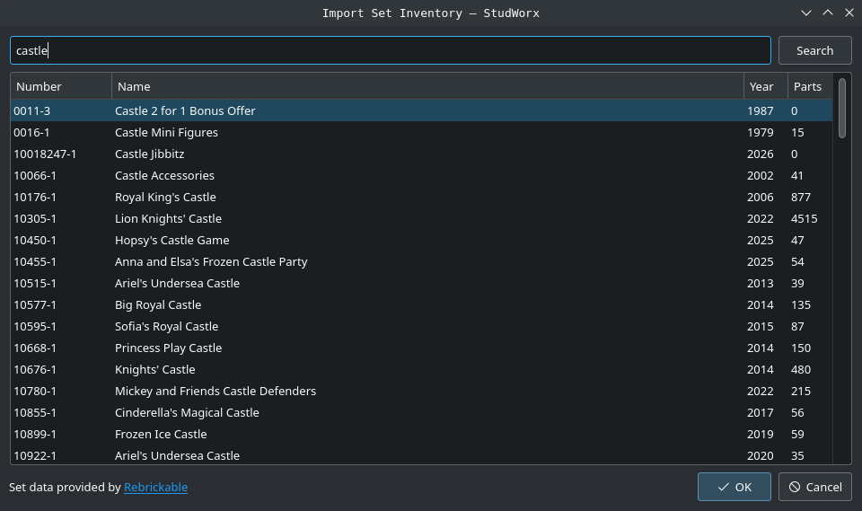


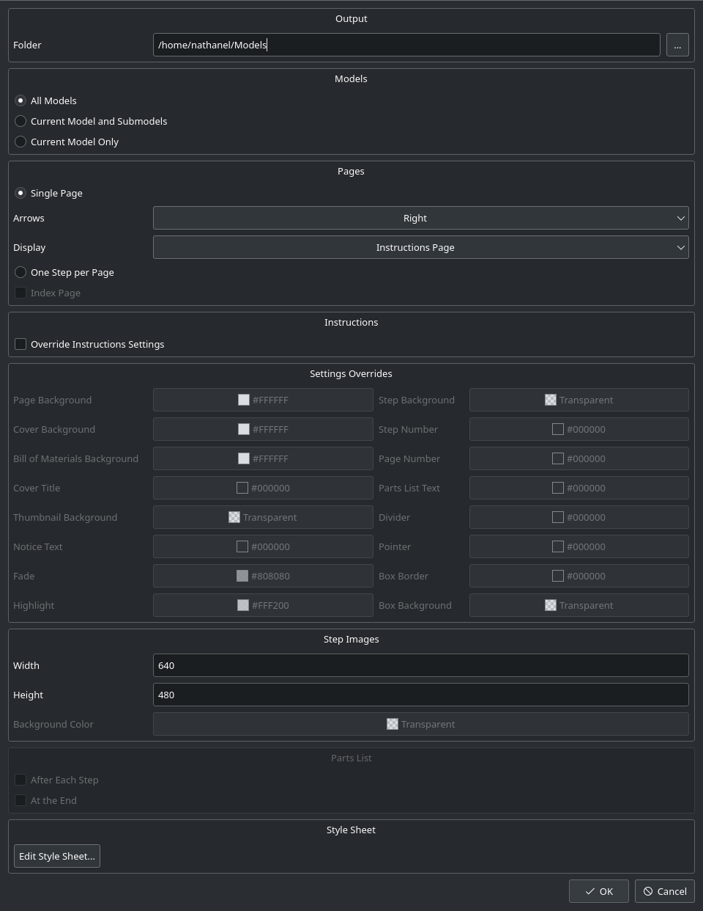
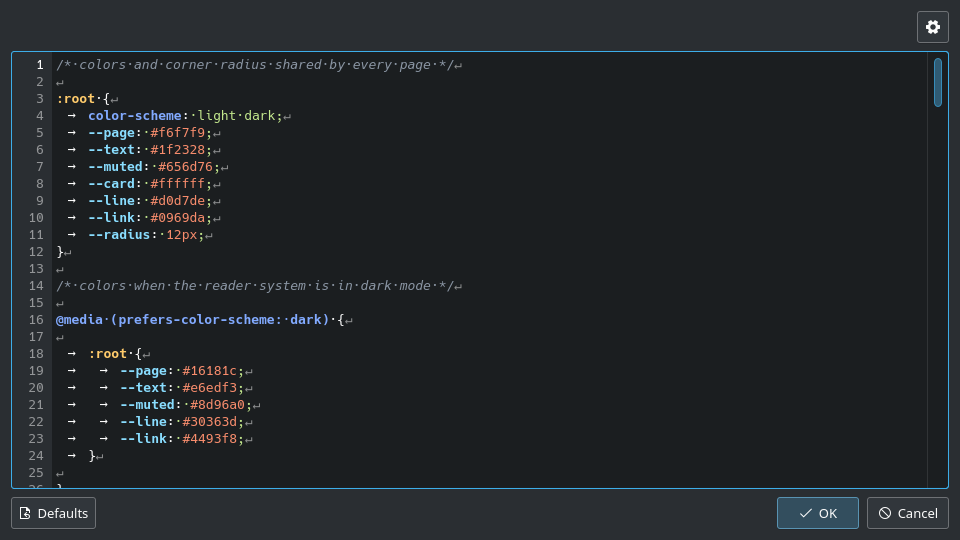


## Image

<!-- image | camera | SAVE MODEL IMAGE // STILLS AND ANIMATED GIFS -->

File > Image saves still images and animated GIFs of the active model. The preview on the left shows exactly what will be saved, and the settings on the right are grouped by what they change. Every setting is kept for the next time.

<!-- gallery three -->

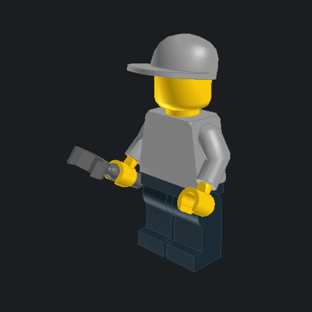
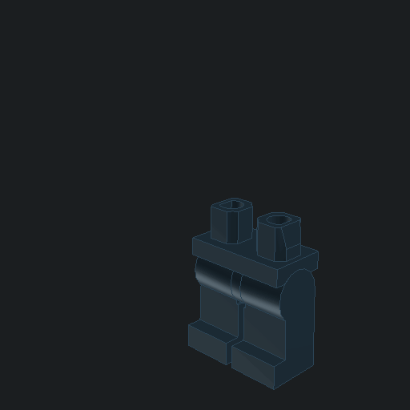
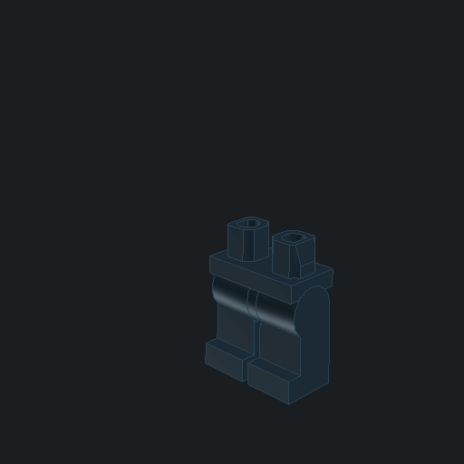

- **Background.** View Color saves the view background opaque. Transparent leaves it empty so the model can be placed over other images. Only PNG and GIF files keep transparency.
- **Steps.** Current Step, All Steps or a Range. Saving several still steps writes one numbered file per step: model.png becomes model01.png, model02.png and so on. The arrows under the preview look through the steps first.
- **Framing.** Keep the view you have, or let StudWorx zoom out until the whole model fits, at every angle and pose, so the picture never jumps. Add some empty space around it if you like.
- **Center and Bounds.** Choose what the model spins around, and whether the fit counts the whole model or only the steps shown.
- **Size.** Pick a shape, like square, 4:3 or 16:9, or the shape of the view, and a size up to 32768 pixels wide or tall.
- **File.** The path runs along the bottom of the dialog, type it or choose it with the ... button. The extension sets the format: .png, .jpg, .bmp, or .gif for animations. Turning Animated GIF on or off switches the extension for you.

### Animated GIF

Check Animated GIF to save one looping GIF. The preview plays it live with a play and pause button, and Motion chooses what moves.

| Setting | Turntable | Steps | Joints |
| --- | --- | --- | --- |
| Axis, Full Turn, Angle | used | off | off |
| Next Step | Off, Turns or Seconds | off | off |
| Turns | revolutions or swings per loop | off | off |
| Frames | per turn, 2 to 360 | one per step, read only | between two poses, 2 to 360 |
| Frame Rate | 0.5 to 50 fps | 0.5 to 50 fps | 0.5 to 50 fps |
| Hold Last | with Next Step on | used | used |
| Duration | read only | read only | read only |

- **Turntable.** The model spins around, either full circles that loop smoothly or a swing back and forth. Choose how many turns, how many pictures and how fast they play.
- **Steps.** Each chosen step becomes one frame, without turning, for short animated instructions. At 2 fps every step shows for half a second.
- **Next Step.** The model keeps turning while the build moves on to the next step every few turns or seconds, and the loop ends on the finished model. It turns at the same speed however many steps there are.
- **Joints.** Blends through the poses of the main model and back to the first, see Joints mode.
- **Hold Last.** Keeps the finished model on screen for 0 to 10 seconds before a loop through the steps or poses restarts.
- **Duration.** Shows how long one loop plays: turns × frames ÷ frame rate for a turntable, steps ÷ frame rate + hold for steps, the frames of every step ÷ frame rate + hold with Next Step, and poses × frames ÷ frame rate + hold for joints. For example, six steps of one turn each, at 24 frames per turn and 12 frames per second with a one second hold, make 144 frames that play for 13 seconds.

### Settings and command line

The dialog keeps its settings in the [Settings] group of ~/.config/StudWorx/StudWorx.conf, saved when you click Save. Still images can also be saved without opening a window with --image and the options in man studworx, including --transparent; animations are saved from the dialog.

| Key | Setting |
| --- | --- |
| ImageWidth, ImageHeight, ImageRatio | Size |
| ImageExtension | File format |
| ImageSteps, ImageTransparent | Steps and Background |
| ImageMotion, ImageAxis, ImageFullTurn, ImageAngleStart, ImageAngleEnd | Motion and turn |
| ImageTurns, ImageFrames, ImageFrameRate | Turns, Frames, Frame Rate |
| ImageNextStep, ImageNextStepTurns, ImageNextStepSeconds | Next Step |
| ImageHoldLast | Hold Last |
| ImageFit, ImageCenter, ImageMargin, ImageFitScope | Framing |

<!-- gallery scroll -->


## Rendering

<!-- rendering | details | RENDERING // LIGHTING, SHADING AND RENDERERS -->

The model view draws fast with OpenGL in four lighting styles, and File > Render hands the model to POV-Ray or Blender for photo quality images.

<!-- gallery four -->


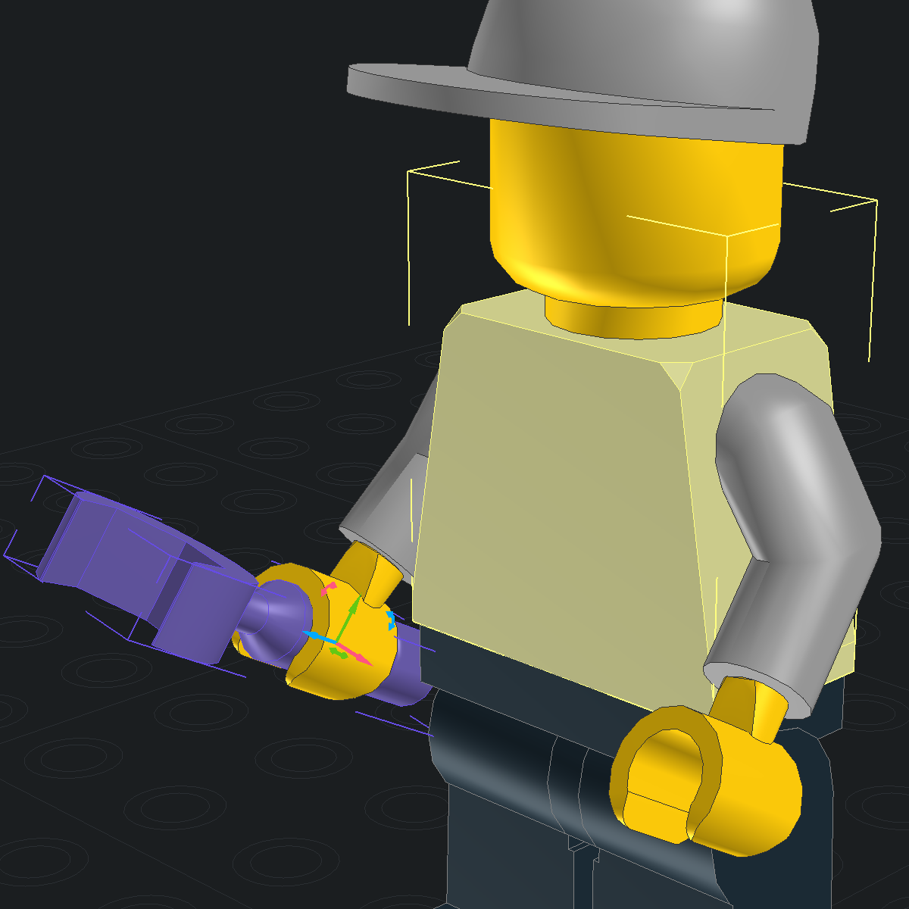

- **POV-Ray.** StudWorx finds POV-Ray 3.7 on its own, bundled on Windows and macOS, or uses the one you pick in Preferences. It can also render with LGEO's high detail parts, downloaded for you when you ask.
- **Render window.** Renders run in their own window beside the model, so you can keep working while the image appears. For POV-Ray, Focal Blur keeps the camera target sharp, a Region renders only the part you draw, and the Editor lets you tweak the scene file by hand before rendering.
- **Blender.** Render with the bundled Blender LDraw add-ons, with the output, image, scene, parts and editing settings in panels of the render window, or Open in Blender to keep working on the scene there. The Blender executable is set in Preferences.
- **Lighting styles.** Four looks for the model: Standard, Studio with three lights, Matte with no shine, and Toon like a cartoon.
- **Shading.** Show parts as wireframes, flat or fully lit, with or without edge lines.
- **Mesh level of detail.** Distant parts draw with simpler meshes, from a distance set in Preferences, so large models stay smooth.
- **Studs.** Draw studs plain, with the LEGO® logo in one of several styles, or in high contrast.
- **Color configurations.** Colors come from the parts library, the LDraw color configuration or the alternate configuration with more realistic edge line colors for rendering, chosen under Rendering > Colors.
- **Edge colors.** Edge lines can take their color from each part's color automatically, or you can pick the edge colors yourself.
- **Separate settings.** The model view, the preview, the parts list and the Minifigure Builder each keep their own wireframe, shading, lighting and edge line settings, or follow the model view's.
- **Selection highlight.** Selected parts get an outline or a tint, and you choose how thick and how see-through it is.
- **Anti-aliasing.** 2x, 4x or 8x samples, and an adjustable line width.

<!-- gallery scroll -->


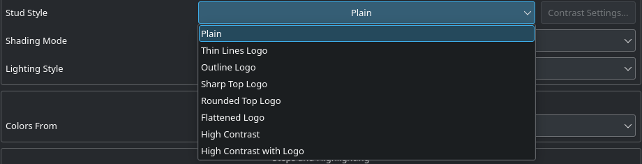

## Modeling

<!-- modeling | color | MODELING // PARTS, SELECTION AND TRANSFORMS -->

Pick a part in the Parts panel, drop it in the model view, then move, rotate, paint and group it. Snapping keeps everything on the LDraw grid, and selection tools find the parts you need in large models.

<!-- gallery four -->


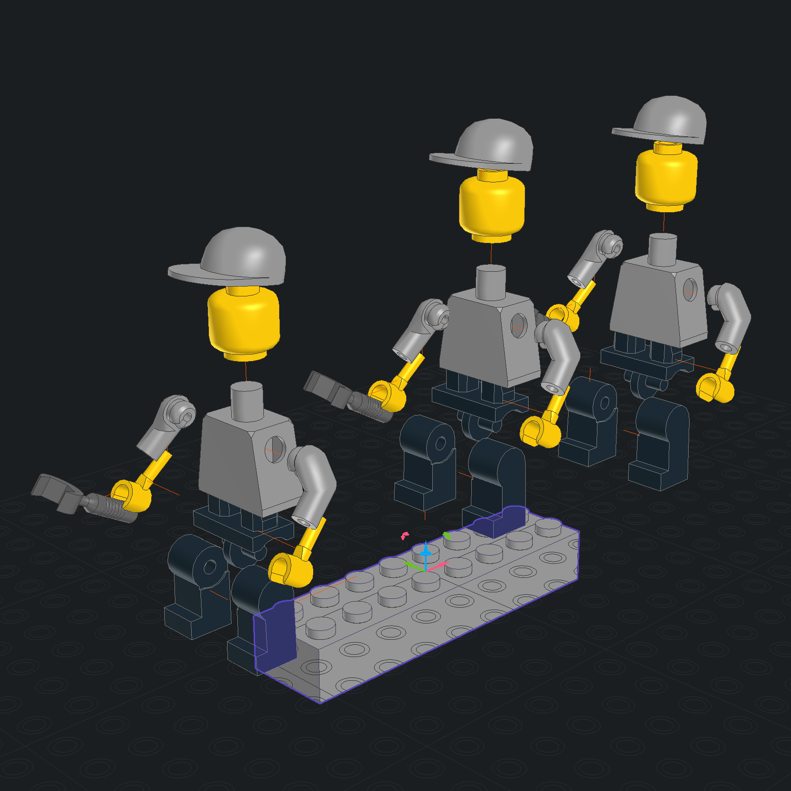
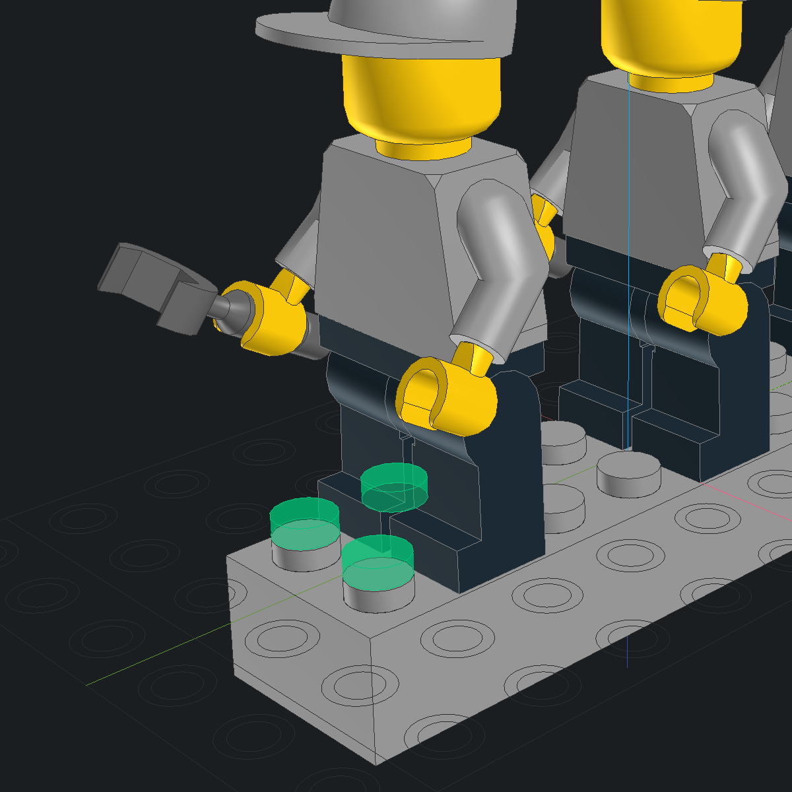

<!-- gallery three -->

[A Flex Path hose follows its end point as it moves, then seats back on its brick](resources/videos/studworx-flex-01.mp4)
[A hose end seated on a newly placed brick, the path bending to reach it](resources/videos/studworx-flex-02.mp4)
[A hose seated on the side of a brick, following it as the bricks move](resources/videos/studworx-flex-03.mp4)

- **Parts.** Add, delete, copy, paint, hide and group parts. The first part of a new model can go straight to the center.
- **Insert colors.** New parts come in the color you choose, the color of the selected part, or the last color you used. You can also lock the Parts panel to one color.
- **Snapping.** Parts move in whole studs, plates and bricks and turn in neat angles, so everything lines up on the LDraw grid.
- **Move snap.** Choose how far a part moves at a time, sideways and up or down, from a tiny 1/20 stud to 8 studs or bricks, or turn snapping off to move freely.
- **Rotation snap.** Parts turn in steps you choose, from 1 to 180 degrees or a custom angle, so they line up neatly, and the view can turn in the same steps. Turns always land exactly on square angles, so later moves keep whole coordinates.
- **Transforms.** Move and rotate the selection in model coordinates or relative to the focused part, and turn several parts together or each around its own pivot. The Transform toolbar takes exact values.
- **Keyboard moves.** Move and turn the selection with the keyboard, one snap step at a time. The arrow keys follow the view, or stay on the model's axes if you prefer.
- **Selection.** Select everything, nothing, the opposite, or parts that touch or connect to the selection. You can also select by name, part or color.
- **Selection modes.** A click picks one part, every part of the same type, every part of the same color, or every part of the same type and color.
- **Select by Name.** A checklist of every object in the model, with All, None and Invert.
- **Part connections.** With the LDCad shadow library, which StudWorx downloads for you, parts know their studs, holes, axles, clips and hinges. Snap to Connections seats a dragged part on the nearest matching connection, turning it to fit side studs and meshing hinge fingers; hold Alt to move it freely. Joint on Snap turns a submodel snapped on a pin into a hinge right away.
- **Find and Replace.** A bar over the view finds parts by shape, color or both, steps through or selects the matches, and replaces their color or part, in submodels too if you want.
- **Array.** Repeat the selection along one, two or three axes, with a count, an X, Y and Z offset and an X, Y and Z rotation for each.
- **Explode.** The Explode panel pulls parts apart to show how they fit: each one slides out along the stud or pin that holds it, by as much as you set, with optional lines showing where it came from. Submodels spread too, Collapse or Undo puts everything back, and Save Copy keeps the exploded model as its own file.
- **Flex Path.** Hoses, cables and other flexible parts bend along points you drag, and never stretch past their real length. Drag an end onto a connection and it clicks into place, and other parts can snap onto the ends.
- **Control points.** Add or remove points along a flexible part like a hose or string, and bend it by turning each point.
- **Groups.** Group parts under a name so they select and move together, and see every group in a tree.
- **Hide and show.** Hide parts that get in the way, then show them again.
- **Show Earlier and Later.** Move the selected parts one building step earlier or later.
- **Train track.** Add track piece by piece: click the ghost track at an open end to pick the next part, and turn a track part to its next connection.
- **Pivot points and keyframes.** Put the turning point of each part back at its center, or clear the animation of the selected parts.
- **Lights and cameras.** Lights and cameras are placed in the model and saved with it, see Tools.

<!-- gallery scroll -->


## Tools

<!-- tools | teal | TOOLS // MOUSE, LIGHTS AND CAMERAS -->

The Tools toolbar sets what the mouse does in the model view. Every tool has a keyboard shortcut, and mouse buttons with modifier keys can start any tool for one drag.

<!-- gallery two -->


- **Edit tools.** Insert adds the part chosen in the Parts panel, Select picks objects, with Ctrl or a drag for several, Move and Rotate change the selection, Erase removes what you click, Paint colors a part, and Color Picker takes a part's color.
- **View tools.** Zoom, Pan, Rotate View and Roll change the camera, and Zoom Region zooms into a rectangle you drag.
- **Keyboard and gamepad view.** Zoom and move the camera with the keyboard, or with a gamepad's left stick in builds that support one.
- **Lights.** Point Light, Spotlight, Directional Light and Area Light tools place lights in the model, with named properties and units, saved in the model file.
- **Cameras.** The Camera tool places a camera. View > Cameras switches between the first sixteen cameras, or No Camera for the free view.
- **Cancel Action.** Esc stops what you're doing: it cancels the current mouse action, closes the find bar, clears the selection, and with nothing selected removes the cutaway.
- **Mouse.** Mouse sensitivity and a shortcut for every tool and view action, recorded in Preferences.

### Joints mode

Give a placed submodel a joint, turn it with the mouse and save the angles as poses of each model, to recall them or play them as an animation.

- **Joints from the shadow library.** Joints and connections come from the shape data of the LDCad shadow library: round shapes become hinges and spheres become balls, and clips and hinge fingers connect too. Square and round box shapes don't connect yet.
- **Set Joint.** Turn a submodel into something that moves, like a minifigure arm or a hinged door: pick the connection it turns on, and StudWorx makes a hinge on a round shape or a ball on a sphere, or a hinge on the part's center when the part has no connection data. A submodel can have several joints, each listed in the Joints panel and saved in the model file.
- **Joints tool.** Grab a jointed submodel and drag to turn it: a hinge turns about its axis, a ball any way. The parts holding joints are outlined in red, and each drag is one undo step.
- **Joint Move and Rotate.** Move and rotate a joint with the usual gizmos and keys instead of the Joints tool. A bar over the view shows where the joint sits in the model and takes you back out when you're done.
- **Joints panel.** Every model with joints in a tree, down to each joint with its type and angle. Click a joint to work on it, or a model to see its poses.
- **Poses panel.** Save the joint angles of a model as a named pose, like sitting or waving, and bring them back in one step. Poses are saved in the model's own file.
- **Joints motion.** Make an animated GIF that moves the model smoothly from pose to pose and back.

<!-- gallery scroll -->


## Views

<!-- views | plane | VIEWS // CUBE, CAMERAS, CUTAWAYS AND GRIDS -->

Look at a model from any side, see inside it without changing it, and measure it against the grid.

<!-- gallery three -->


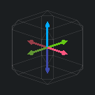


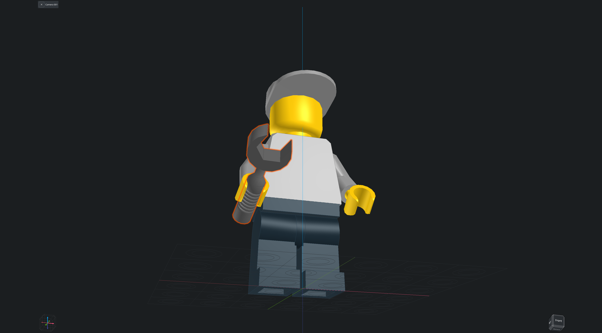

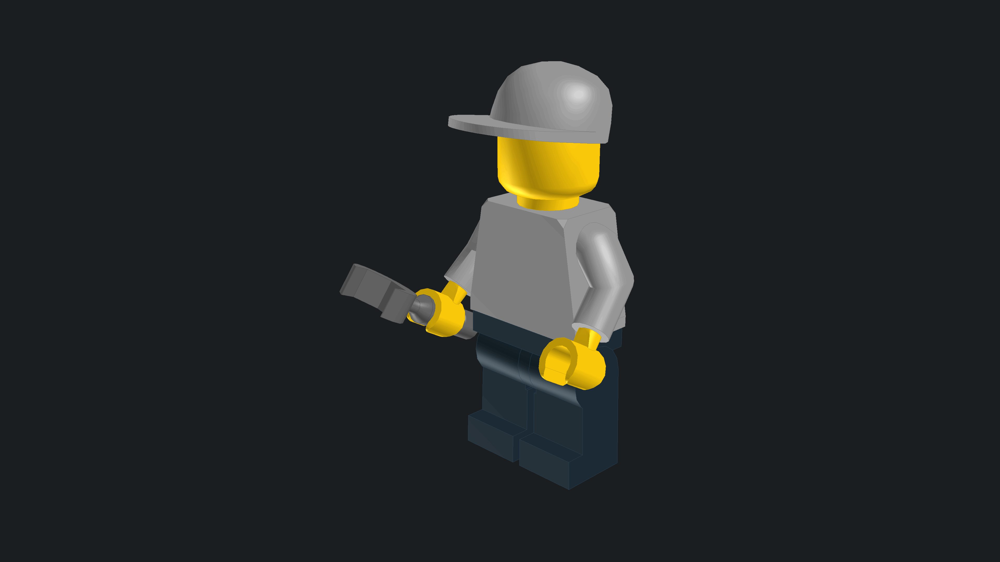

- **View cube.** Chamfered edges and corners: click any of its 6 faces, 12 edges or 8 corners for that view.
- **View cube settings.** Put the view cube in any corner, at any size, with your own colors, and full or short names on its faces.
- **Axis icon.** X, Y and Z labels with optional negative axes. The view cube, axis icon and part thumbnails come in Extra Small to Extra Large.
- **Axis icon settings.** Put the axis icon in any corner, with or without labels and negative axes, in your own colors.
- **Preview overlays.** The preview shows its own view cube and axis icon, each turned on and off from its options.
- **Viewpoints.** Jump to a front, back, top, bottom, left, right or home view, zoom to fit the whole model, look at the selection, or face a part straight on.
- **Projection.** Perspective or orthographic, for the active view or all views at once.
- **Cameras.** Cameras you place get numbered names, and a floating camera bar switches between them.
- **Cutaways.** Cube, sphere and cylinder cutaways with solid cut surfaces, a shaded cut and resize knobs, pushed in or pulled out by one plate. The cutaway is saved with the model and comes back when the file opens, and the parts themselves are never changed.
- **Cutaway controls.** Make the cutaway bigger or smaller, push it in or pull it out, change the shade of the cut, or remove it.
- **Cut edges.** With edge lines on, the cut draws edge lines in each part's edge color where it meets the outer faces, and thinner lines along the corners of the cut faces. Cut Edges in Preferences > Views > Cutaway turns them off.
- **Grids.** A base grid under the model and height grids beside it grow with the model, so you can always see how big it is in studs and plates. Turn each grid and axis line on or off.
- **Grid settings.** Line spacing, stud and line colors, and Height Grids Behind Model to keep the height grids behind the parts.
- **Idle turntable.** The model turns full screen around the X, Y or Z axis when you leave StudWorx idle. Any input ends it. The idle time and the time for one turn are set in Preferences.

## Steps

<!-- steps | yellow | STEPS // BUILD ORDER AND TIMELINE -->

Every part belongs to a building step. Steps drive the model view, the instructions and the animated GIFs.

<!-- gallery two -->


- **Steps menu.** Move through the building steps, add or delete steps, and play them back like an animation.
- **Timeline.** Shows the step each part is added in and removed in. An empty removal step reads Never. Drag parts between steps or reorder them, and Set Current Step from a step's right-click menu.
- **Move and paste.** Move the selected parts to an earlier or later step, add steps from the Timeline, and paste parts together with their steps.
- **Step views.** Steps can turn the model to their own view angle, like the ROTSTEP command of MLCad, and the Timeline shows and edits them.
- **Keys in the Timeline.** Each step with animation keys lists a Keys row per keyed object naming its keyed properties, and a double click on it selects that object at that step and shows the Keyframes panel.
- **Step view commands.** Give each step its own view angle, so the model turns to show that step best as you go through them.
- **Emphasis.** Make the build easier to follow: highlight the new parts of each step, fade the earlier ones, fade the rest of the model while you edit a submodel or set a joint, outline the submodel under the pointer, and mark the connection points of the part you point at, in a see-through color if you like, or not at all.
- **Animation keys.** Animation keys remember where parts, lights and cameras are at each step. Add Keys records them as you work, and a round button in the Properties panel adds or removes one.
- **Keyframes panel.** A full-width timeline of the animation, one column per step and one row per object, with a diamond for each key. Add, remove and drag keys, and play the animation from the panel or the Time toolbar.

<!-- gallery scroll -->


## Panels

<!-- panels | wireframe | PANELS // PARTS, COLORS, PROPERTIES AND MORE -->

Panels dock side by side in any area of the main window, with uniform headers, buttons and text boxes sized from their options button.

- **Parts.** Categories and palettes with a filter. The panel snaps to whole thumbnail tiles and rows, docked or floating, and the tooltip of each part shows its name, ID and weight.
- **Part palettes.** Create, rename, reorder and delete palettes, import them, or build one from an online set inventory.
- **Colors.** Collapsible solid, translucent and special color groups with square color tiles.
- **Properties.** Compact position, rotation and transform rows and a spanning color swatch. Lights and cameras get named rows with units. A round key button ends each animated row, filled when the property has a key at the current step.
- **Minifigure Builder.** Build a minifigure from templates and add several variations to the model.
- **Preview.** A small view of the part or model you picked, docked or floating, that can keep showing the last selection.
- **Explode.** The controls of the explode feature, described under Modeling.
- **Joints.** The joints of the selected submodel and their axis, a tree of every model with joints, and right-click menus to move, rotate or delete them.
- **Poses.** The poses of the model picked in the Joints panel with Save, Recall, Rename and Delete.
- **Keyframes.** A full-width timeline of the keys of the selected or all objects per step, with buttons to add or remove keys, Add Keys and playback.
- **Terminal.** An embedded terminal sized to whole rows and columns, with Open Model Folder.
- **Terminal folders.** Follow Model Folder moves the terminal to the folder of each model you open, and Go to Model Folder moves it there once.

<!-- gallery scroll -->


## Instructions

<!-- instructions | blue | INSTRUCTIONS // PAGES READY TO PRINT -->

File > Instructions lays the steps out on pages with a cover, parts lists and a bill of materials. Every page element can be styled and placed, and everything is saved in the model file as !SW INSTRUCTION meta commands.

<!-- gallery three -->


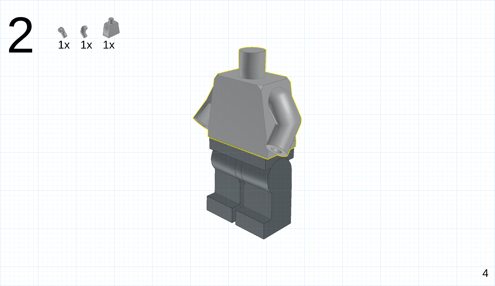


- **Page setup.** Paper and screen presets, metric or imperial units, margins and orientation.
- **Page bar.** Turn the instruction pages, jump to the cover or the bill of materials, type a page number, and insert or remove blank pages and empty steps.
- **Pages.** Instructions get a cover with the title and author, a list of every part, and as many steps per page as you want, each page with its own background.
- **Style.** Choose the font, how steps are divided, how the model is drawn, and how the parts list looks and is sorted.
- **Step images.** Parts new to each step are outlined and the earlier ones fade.
- **Placement.** Drag every page element where you want it, or lock it in place. Elements snap to a page grid, or to the edges and centers of the page and the other elements.
- **Elements.** Every page element, like page numbers or the parts list, can have its own colors, fonts, border, rounded corners and background. Notices and pointers draw attention to parts and steps.
- **Rulers.** Rulers along the page measure it in your units, show the margins, and follow the pointer with a small arrow.
- **Element inspector.** Like a web browser's inspector, it shows the space around and inside every page element, so you can line things up. It never prints.
- **Editor, Export HTML and Print.** An Editor panel to read and edit the model file text, whose height snaps to whole lines so no line is ever cut off, Export HTML for the instruction pages, and a built-in Print panel.

<!-- gallery scroll -->


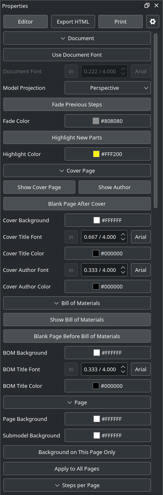
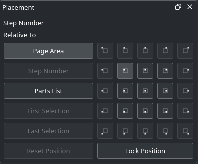


## Models

<!-- models | green | MODELS // SUBMODELS AND PROPERTIES -->

Large builds split into submodels that you can edit on their own or in place, inside the model that uses them.

<!-- gallery one -->


- **Properties.** Lists every part of the model with its ID, picture, count and weight, plus the size and weight of the whole model, in metric or imperial. Export the list for BrickLink or as a spreadsheet.
- **Submodels.** Group parts into submodels you can reuse, open them on their own, or melt them back into plain parts, from the menu or the command line.
- **Submodels list.** Create, rename, duplicate and delete submodels, set the active one, and export them as separate LDraw files.
- **Models menu.** Switch between up to forty models of the file from the Models menu.
- **In-place editing.** Edit a submodel inside its parent. A path bar shows where you are, and its buttons go back to each model.
- **Editing commands.** Step into the selected submodel to edit it in place, and step back out to its parent.
- **Names.** Consistent default names and numbered duplicates: Submodel 001.ldr, and Car.ldr becomes Car 001.ldr.

<!-- gallery scroll -->


## Preferences

<!-- preferences | grid | PREFERENCES // EVERY SETTING IN ONE PLACE -->

Nine pages with lined up label and control columns, checkboxes included, each label greyed out with its control. Value boxes show their maximum and bring any typed number into range, and every slider shows its value.

- **General.** Where StudWorx finds the parts library, Blender, POV-Ray and LGEO, with one-click updates for colors, minifigure parts and the BrickLink mapping. Also your Rebrickable key and the author line written into new models.
- **Startup and files.** What happens when StudWorx starts and when you open a file: reopen the last model, wait for every part, warn about missing parts, notice changes made elsewhere, and what to do with LeoCAD models.
- **Rendering and Views.** Rendering sets how parts look, and Views sets what the model view shows around them, from the view cube to the grids.
- **Interface and Instructions.** Interface holds every display color. Instructions holds the default page settings, the rulers and inspector, and the editor options.
- **Display colors.** Every color StudWorx draws with, from the background and grids to selections, highlights, axes and the instruction page guides, see-through where it makes sense.
- **Categories.** Part categories turned on and off with a checkbox, edited, imported and exported.
- **Context Menu.** Arrange the right-click menu of the model view the way you work: add, reorder, rename or group its commands, or reset it. Right clicking an unselected part selects it first.
- **Keyboard and Mouse.** Shortcuts recorded by clicking, importable and exportable. Commands that share a shortcut show in red, and assigning a taken shortcut asks before moving it.
- **Shortcut filters.** Filter commands and tools by name or shortcut, give each two shortcuts, and reset them to the defaults.
- **From LeoCAD.** Settings, part palettes and minifigure templates are copied from LeoCAD on the first start.

<!-- gallery scroll -->


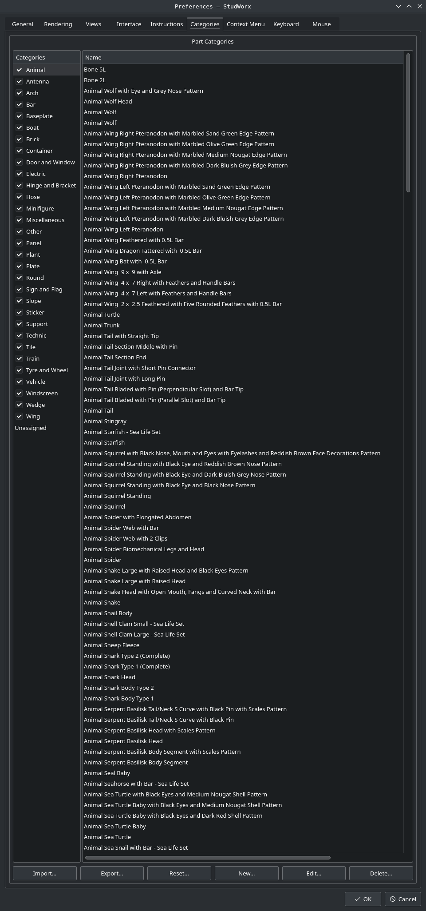


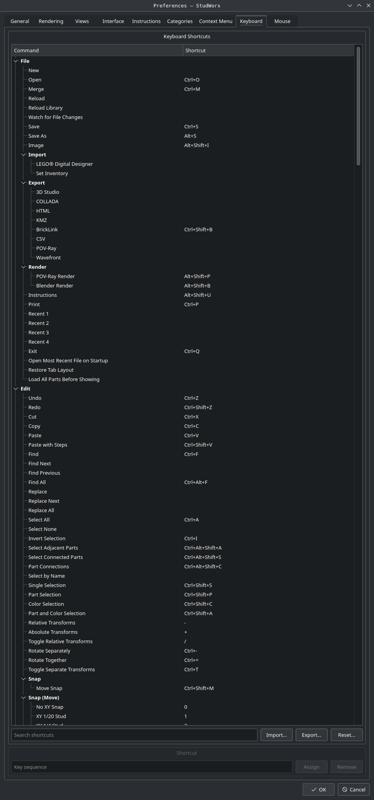


## Meta

<!-- meta | edge | META COMMANDS // LDRAW LINE HANDLING -->

Every meta command StudWorx reads, writes or keeps: the official LDraw ones, its own !SW commands, LeoCAD commands it migrates, and the commands of MLCad, LPub, LSynth, L3P, LDLite and Blender.

<!-- include meta -->

## Where Is It

<!-- where | baseplate | WHERE IS IT? // EVERY COMMAND AND ITS MENU -->

Where to find each of the @COMMANDS@ commands: the menu bar, the toolbars, the panel gear buttons and every right click menu, with its shortcut. Type part of a command name to find it.

<!-- include where -->

## Help

<!-- help | purple | HELP // EVERY "WHAT'S THIS?" ENTRY -->

The same help the app shows from Help > "What's This?", the title bar question mark or F1: @ENTRIES@ entries for every menu command, panel and dialog. Search them, or pick an area.

<!-- include search -->

## Install

<!-- install | orange | INSTALL // DOWNLOAD, BUILD AND RUN -->

Packages are rebuilt from every change and carry the date version of the release. They include their own Qt libraries and the LDraw parts library.

| System | Package |
| --- | --- |
| Debian, Ubuntu | studworx_@VERSION@_amd64.deb / arm64.deb |
| Fedora, Rocky Linux, RHEL, openSUSE | studworx-@VERSION@-x86_64.rpm / aarch64.rpm |
| Any Linux based system | studworx-linux-@VERSION@-x86_64.appimage / aarch64.appimage |
| Windows | studworx-windows-@VERSION@-x64.exe |
| macOS | studworx-macos-@VERSION@-universal.dmg |

[Download the latest release ›](https://github.com/nathaneltitane/studworx/releases/latest)

- **Linux based systems.** The .deb and .rpm packages install to /opt/studworx. The AppImage runs from anywhere after chmod +x. Tested on Debian 12 and 13, Ubuntu 22.04 and 24.04, Rocky Linux 9, Fedora and openSUSE Tumbleweed.
- **macOS.** The disk image is not notarized: on the first start, right click StudWorx and choose Open.
- **Prepare.** To build, install a C++ compiler, Qt 5 (widgets, OpenGL, print support, network, xml and concurrent modules) and zlib development packages, listed below as build requirements. The optional packages add gamepad input, the terminal panel with KDE Frameworks KParts and a KDE Frameworks 5 Konsole, and the file manager thumbnails with KIO.

| System | Build requirements | Optional |
| --- | --- | --- |
| Debian, Ubuntu | g++ make qtbase5-dev qttools5-dev-tools libqt5opengl5-dev libqt5svg5 qt5-image-formats-plugins zlib1g-dev | libqt5gamepad5-dev libkf5parts-dev libkf5kio-dev |
| Fedora, Rocky Linux, RHEL | gcc-c++ make qt5-qtbase-devel qt5-linguist qt5-qtsvg qt5-qtimageformats zlib-devel | qt5-qtgamepad-devel kf5-kparts-devel kf5-kio-devel |
| openSUSE | gcc-c++ make libqt5-qtbase-devel libqt5-linguist libqt5-qtsvg libqt5-qtimageformats zlib-devel | kparts-devel kio-devel |
| Arch Linux | base-devel qt5-base qt5-tools qt5-svg qt5-imageformats zlib | qt5-gamepad kparts5 kio5 |

```
git clone https://github.com/nathaneltitane/studworx
cd studworx
qmake studworx.pro
make -j"$(nproc)"
```

Or build and install with the thumbnail plugin, file types and associations registered. The prefix defaults to /usr/local, and ~/.local installs without superuser rights. Run it again after git pull to update.

```
git clone https://github.com/nathaneltitane/studworx
studworx/tools/studworx-install [prefix] [build directory]
```

- **Run.** Start StudWorx and it downloads the LDraw parts library the first time, or point it to one you already have. Download the shadow library in Preferences to make parts snap together.
- **Package.** Run resources/packaging/deb/deb.sh, resources/packaging/rpm/rpm.sh or resources/packaging/appimage/appimage.sh, with an optional build directory.

## News

<!-- news | fuschia | NEWS // LATEST CHANGES -->

The latest release notices from the StudWorx repository.

<!-- include notice -->

[Read every notice ›](https://github.com/nathaneltitane/studworx/blob/main/NOTICE.md)
