# Site

Every section of [studworx.app](https://studworx.app), features first. `tools/studworx-site` builds the page from this file. Each `##` section starts with a comment that sets its page id, icon and heading, and its first paragraph is the lead. A `<!-- gallery class -->` comment turns the images and video links below it into one gallery, and the title of a single image sets its figure class. A `<!-- video -->` comment turns the link below it into a looping video, with the link text as its caption. A `<!-- include name -->` comment places generated content: the meta command list, the help search or the latest notices. A paragraph made of a single link ending in › becomes a more link, and `@VERSION@` and `@ENTRIES@` are filled with the release version and the help entry count.

## Interface

<!-- interface | console | INTERFACE // MENUS, TOOLBARS AND HELP -->

StudWorx is built from standard Qt widgets: panels, dialogs and windows follow your system style and light or dark theme, and only the model views draw with OpenGL. Menus are grouped by task, every icon and cursor is drawn in code so it stays sharp at any size, and every dialog and panel explains itself.

- **Menus by task.** File, Edit, View, Part, Steps, Models and Help, with clean labels and a unique mnemonic in each menu. Edit holds the Selection Mode, Transform and Tools submenus, View the Toolbars, Viewpoints, Cutaway, Cameras, Projection and Shading submenus, and Part the Joint, Group and Visibility submenus.
- **Options menus.** A gear button opens the settings that belong to its place: grids, steps and highlighting and view overlays on the model view, list display and filtering on Parts, the insert color on Colors, overlays and selection on Preview, shading and lines on the Minifigure Builder, the model folder on Terminal, editing on the Editor and page setup on the instructions Properties.
- **Toolbars.** Standard, Tools and Time toolbars. Move and rotate cursors show the axis they work on.
- **Transform toolbar.** Type a position or rotation for the selection and apply it, as absolute coordinates or relative to where it is now. It has no entry of its own: its fields sit at the bottom of the Properties panel, shown with View > Toolbars > Properties Panel.
- **Tabs, splits and status bar.** Open several models in tabs, close one with the close button at the end of its tab or Close Tab (Ctrl+W), or the others from the tab's right-click menu, split the view and go Full Screen. The status bar shows the selection, the view orientation and projection, the focus position, the snap and transform settings and the current step. The selection reads the name, ID and weight of the selected part, a submodel reading ID N/A and the total weight of its parts when all of them have one, and the total weight of two or more selected parts. Right click the status bar to show or hide each segment.
- **Split views.** Split Horizontal and Split Vertical divide the current view as often as you like, Remove View closes one, or Reset Views back to one. Each view keeps its own camera and projection, a border marks the active one, and the view cube and axis icon stay on the top left view.
- **Toolbars and panels on demand.** View > Toolbars shows or hides each toolbar and panel: Standard Toolbar, Tools Toolbar, Time Toolbar, Parts Panel, Colors Panel, Properties Panel, Timeline Panel, Preview Panel, Terminal Panel, Minifigure Builder Panel, Explode Panel, Joints Panel, Poses Panel and Keyframes Panel.
- **Lock Interface.** At the end of the same menu, also on a right click on any toolbar or panel title. Panel title bars are hidden to save space, panels and toolbars stay where they are with no dragging, floating or redocking, and the choice is remembered. Panels still resize, the menu still shows or hides them, and model tabs still move.
- **Undo and clipboard.** Undo and Redo every change, and Cut, Copy and Paste parts between models and tabs. Paste with Steps keeps the steps of the copied parts.
- **Contextual help.** Choose Help > "What's This?" or click the question mark in a title bar, then click any control to read what it does. F1 explains the focused control, Shift+F1 starts "What's This?" inside a dialog, and every entry is listed in the Help index below.
- **Help menu.** Home Page opens the StudWorx repository on GitHub, Report a Bug its issues, and About shows the version and system information.
- **Ten languages.** English, French, German, Spanish, Portuguese, Czech, Ukrainian, Russian, Simplified Chinese and Traditional Chinese.
- **Color theme.** Follow the system, or force the light or dark theme, from Preferences.

<!-- gallery scroll -->

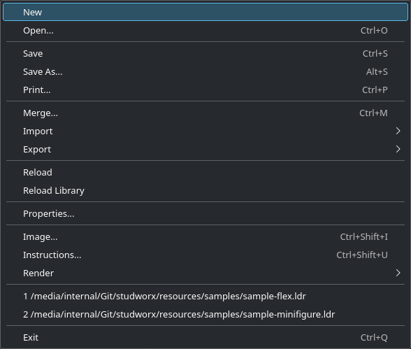
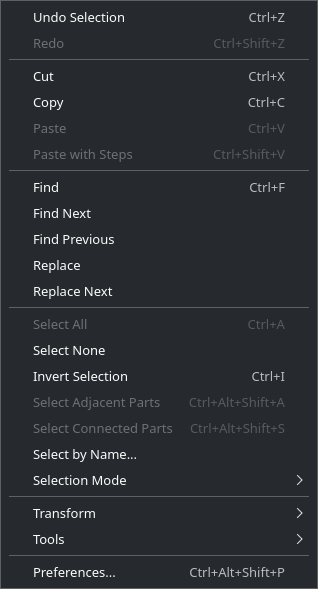
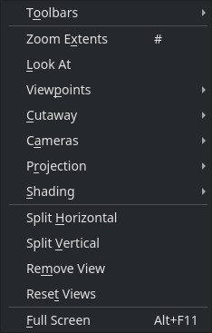
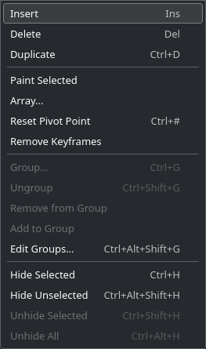

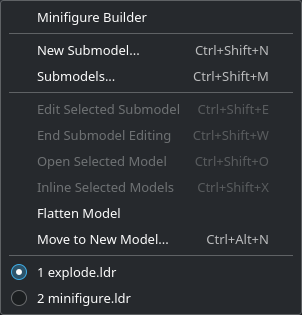
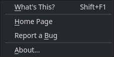


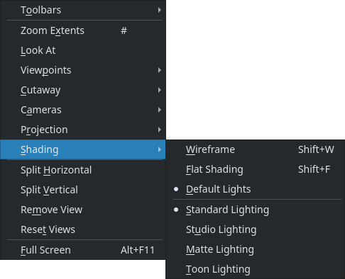
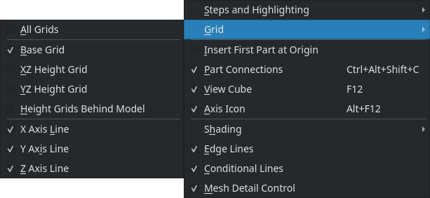
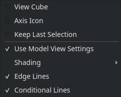
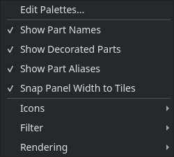
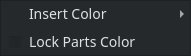
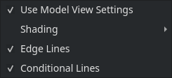
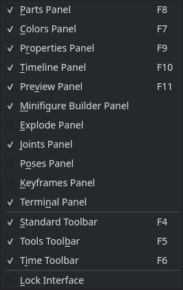
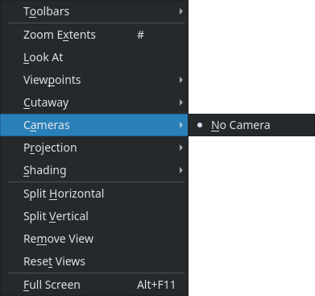
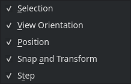
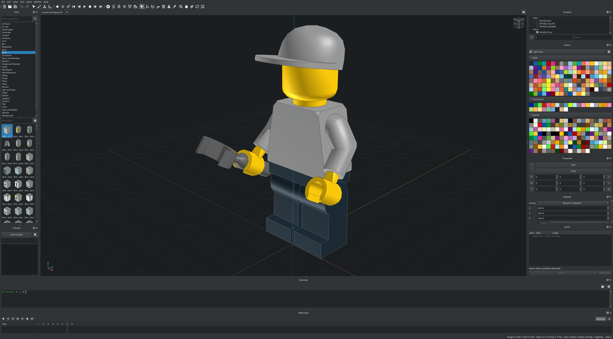
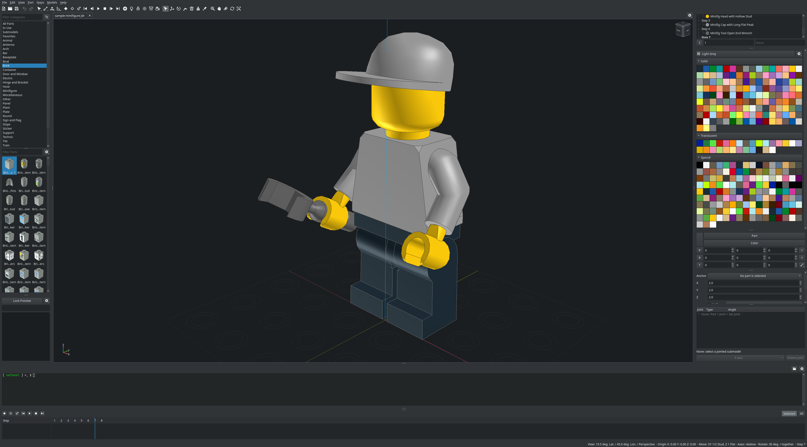
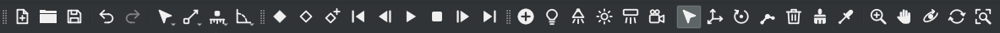
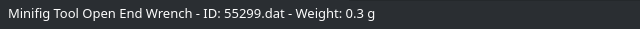
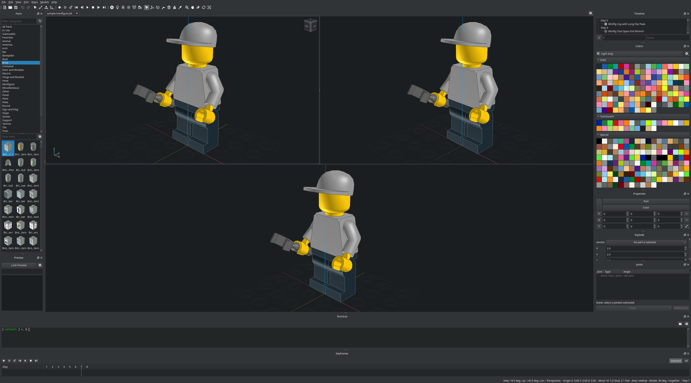

## Files

<!-- files | grey | FILES // OPEN, IMPORT, EXPORT AND PRINT -->

Models are plain LDraw text files in LeoCAD's format, so they open in either program. StudWorx reads and writes them, imports from other tools, exports to 3D and parts list formats, and prints the current view.

<!-- gallery one -->

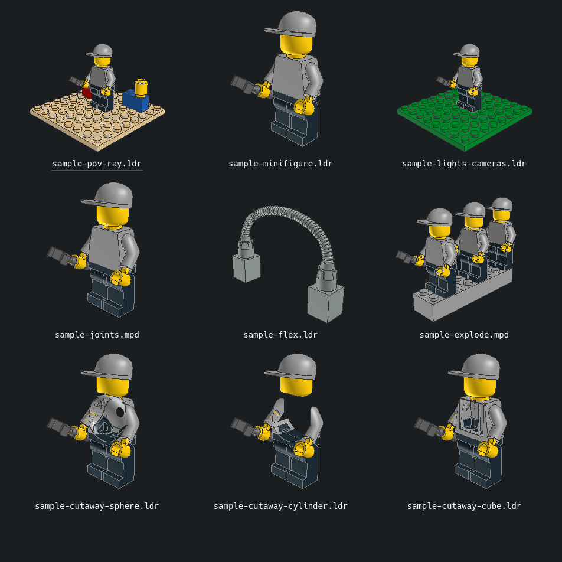

- **LDraw models.** .ldr, .mpd and .dat files, with New, Open, Merge, Save, Save As, Reload and the four most recent files. Save As follows the LDraw file specification and adds the extension when it is left out: .ldr for a single model, .mpd for a model with submodels or embedded data. Files are written with Unix line endings, and a model loaded with Windows line endings keeps them when saved. Watch for File Changes reloads a model edited in another program. Sample models, a minifigure, cube, sphere and cylinder cutaways of it, an exploded model, a flexible part, a posable minifigure with joints, lights and cameras, a scene with POV-Ray lights, floor and camera, and an S-curve of 9V train track, install to /usr/share/studworx/samples, the samples folder beside the program on Windows, or the application bundle resources on macOS.
- **Startup.** Open Most Recent File on Startup reopens the last model, Restore Tab Layout brings back its tabs and split views, and Load All Parts Before Showing waits until every part is loaded before the model appears.
- **LeoCAD models.** Models saved by LeoCAD open as they are, and their LeoCAD meta commands are migrated to StudWorx ones, automatically when you choose so in Preferences. Older LeoCAD projects (.lcd) open and merge too, and save as LDraw.
- **Import.** LEGO® Digital Designer models (.lxf and .lxfml), also opened with Open, recent files, drag and drop and the command line as an untitled project, with a bundled part and color mapping, and official set inventories with File > Set Inventory. Set inventories use your own free Rebrickable API key, asked for once or set under Online Services in the preferences, and are searched by set name or number.
- **Export.** 3D Studio, COLLADA, Wavefront, KMZ, POV-Ray, HTML pages from the Instructions window, BrickLink wanted lists and CSV parts lists. BrickLink exports pick the condition, the wanted list by its number or the address of its page, and new listing notices, copy the XML and open the BrickLink upload page in one step, and translate part numbers and colors through a bundled mapping of over 55,000 parts or a file built from the library and Rebrickable, with Rebrickable numbers taking the lead over stale part keywords. BrickLink and CSV exports list parts the library moved to a new number under that number, and Part Exceptions in the BrickLink export keeps a comma or tab separated list of parts whose BrickLink number you set by hand.
- **KMZ.** Google Earth and SketchUp models, with the visible surfaces only or every part's geometry, set in Preferences.
- **COLLADA.** Translucent colors can be marked as transparent materials for programs that read them.
- **HTML.** Export HTML in the Instructions window writes styled pages in a folder named after the model, opening at index.html, with light and dark colors that follow the browser. One scrolling page of the Instructions window pages that stops at each page, with #page-N and #step-N links and First, Previous, Next and Last Page arrows on the right, left or bottom edge, laid out for the Instructions Page, a Landscape Display, Portrait Display or Tablet shape in pixels and saved at twice that size for sharp high density screens, or one step per page with an index, step images of any width and height on a background color you choose, transparent with its alpha, framed in rounded tiles of the same color, and a parts list after each step or at the end, which Override Instructions Settings also applies to the scrolling page with Settings Overrides for the page, cover, Bill of Materials, step, text, divider, pointer, fade, highlight and element box colors, without changing the model, for the current model, its submodels or all models. Edit Style Sheet changes the CSS of the pages in an editor with the options and find and replace of the Editor panel, its comments naming the feature of each block.
- **Print.** File > Print prints the current model view through the system print dialog, with a Preview button where the dialog allows it.
- **Missing and moved parts.** Opening a model lists the parts that could not be loaded and the parts the library marks as moved or as an alias, with where each is used. Moved parts and aliases are offered the part they point to, missing parts are looked up through the BrickLink mapping, and Replace Checked swaps the checked ones in every submodel, keeping colors and positions, in one undo step. Copy List copies the list, Don't Warn Again or the Warn About Missing and Moved Parts preference stops the list on open, and the status bar icon opens it again.
- **Thumbnails.** Model thumbnails in file managers, from a KDE thumbnail plugin or the desktop thumbnailer.
- **Parts library.** Downloaded on the first start as the official LDraw complete.zip, or chosen from an archive you already have, and reloaded with File > Reload Library. An unofficial parts folder can be added beside it.
- **Command line.** Render images, transparent images with --transparent and POV-Ray renders, and import or export settings, shortcuts and categories without opening a window. See man studworx. [L²CU](https://l2cu.app), the LDraw command line utility for Linux based systems, drives these renders and exports for whole folders of models.
- **Exit.** File > Exit asks to save each changed model before StudWorx closes.

### Command line

studworx model.ldr opens a model. The options below work without opening a window, and man studworx describes each one.

| Options | What they do |
| --- | --- |
| -l, --library, --unofficial-library, --shadow-library | Choose the parts, unofficial parts and LDCad shadow libraries |
| -i, --image, -w, --width, --height | Save an image of the model at a size |
| -f, --from <step>, -t, --to <step>, -s, --submodel | Save a range of steps, or one submodel |
| -c, --camera, --viewpoint, --camera-angles, --camera-position, --camera-position-ldraw | Choose a camera, a viewpoint or an exact camera position |
| --projection, --field-of-view, --clip-planes, --transparent | Projection, field of view, clipping planes and a transparent background |
| --fade-steps, --no-fade-steps, --fade-color, --highlight, --no-highlight, --highlight-color | Fade previous steps and highlight new parts |
| --shading, --lighting, --line-width, --antialiasing-samples | Shading mode, lighting style, edge line width and anti-aliasing |
| --stud-style <id> | One of the eight stud styles, 0 to 7 |
| --edge-color, --edge-color-black, --edge-color-dark, --stud-cylinder-color, their --no- forms, --edge-color-automatic, --edge-contrast, --edge-light-dark | Edge, black edge, dark edge and stud cylinder colors, automated edge colors, contrast and light to dark value |
| --bricklink-condition, --bricklink-wanted-list, --bricklink-notify | Set the condition wanted, the wanted list to add to, and ask BrickLink to notify new listings |
| --bricklink-exceptions | Use a comma or tab separated file of parts and their BrickLink numbers in BrickLink exports |
| --flatten | Replace every submodel at all depths with its parts and save the model, before any other export |
| --undo | Undo every command line edit and save the model, to check that undo restores it |
| --export-wavefront, --export-3ds, --export-collada, --export-kmz, --export-csv, --export-bricklink, --export-html, --export-povray | Export Wavefront, 3D Studio, COLLADA, KMZ, CSV, BrickLink, HTML and POV-Ray files, each with an optional file name |
| --kmz-geometry | Keep every part or only the visible surfaces in KMZ exports |
| --render-povray | Render with POV-Ray, with an optional file name |
| --import-settings, --export-settings | Settings as an ini file |
| --import-keyboard-shortcuts, --export-keyboard-shortcuts, --import-mouse-shortcuts, --export-mouse-shortcuts | Keyboard and mouse shortcuts |
| --import-categories, --export-categories | Part categories |
| -v, --version, -h, --help | Version and usage |

<!-- gallery scroll -->

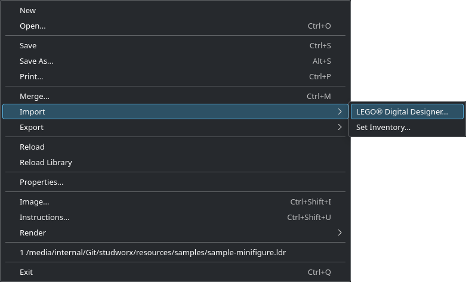

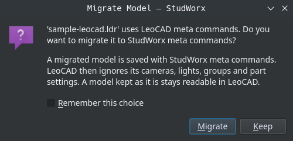
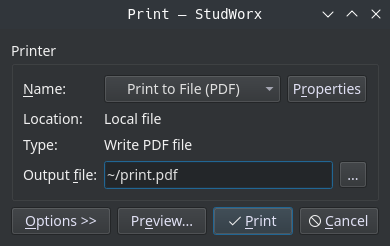
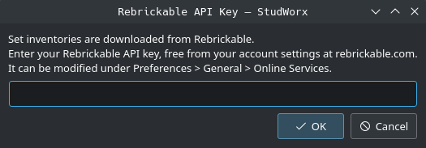

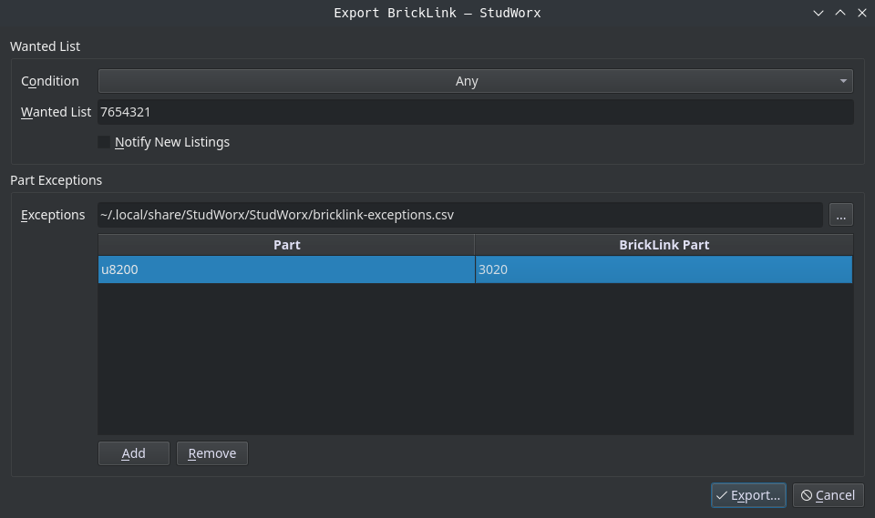


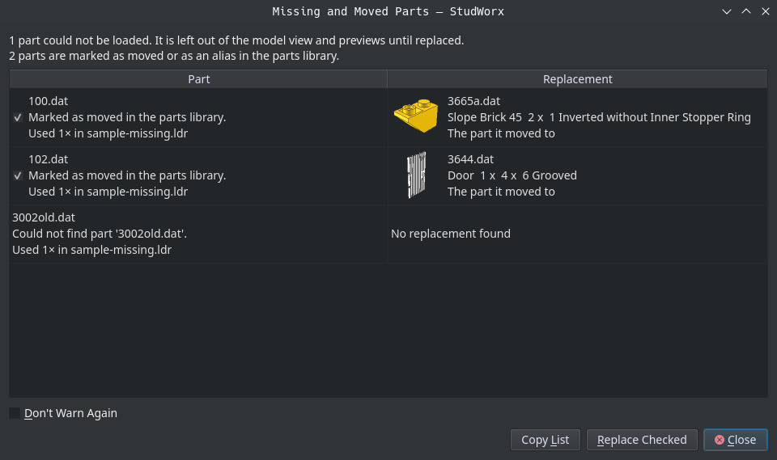

## Image

<!-- image | camera | SAVE MODEL IMAGE // STILLS AND ANIMATED GIFS -->

File > Image saves still images and animated GIFs of the active model. The preview on the left shows exactly what will be saved, and the settings on the right are grouped by what they change. Every setting is kept for the next time.

<!-- gallery three -->


- **Background.** View Color saves the view background opaque. Transparent leaves it empty so the model can be placed over other images. Only PNG and GIF files keep transparency.
- **Steps.** Current Step, All Steps or a Range. Saving several still steps writes one numbered file per step: model.png becomes model01.png, model02.png and so on. The arrows under the preview look through the steps first.
- **Framing.** Current View saves what the model view shows. Fit Model moves the camera back until every part fits, at every turntable angle and every pose, so a Joints animation holds still. Fit Each Step fits every step on its own parts. Margin keeps 0 to 50 percent of empty space around the model.
- **Center and Bounds.** Turntables turn around the World Origin, the Model Origin or the Model Center. Bounds measures the fit on the Whole Model, so every step lines up, or on the Shown Steps only.
- **Size.** Ratio presets from 1:1 Square through 5:4, 4:3, 3:2 and 16:10 to 16:9 and 21:9, Free, or the shape of the View. Width and Height go up to 32768 pixels, in Landscape or Portrait.
- **File.** The path runs along the bottom of the dialog, type it or choose it with the ... button. The extension sets the format: .png, .jpg, .bmp, or .gif for animations. Turning Animated GIF on or off switches the extension for you.

### Animated GIF

Check Animated GIF to save one looping GIF. The preview plays it live with a play and pause button, and Motion chooses what moves.

| Setting | Turntable | Steps | Joints |
| --- | --- | --- | --- |
| Axis, Full Turn, Angle | used | off | off |
| Next Step | Off, Turns or Seconds | off | off |
| Turns | revolutions or swings per loop | off | off |
| Frames | per turn, 2 to 360 | one per step, read only | between two poses, 2 to 360 |
| Frame Rate | 0.5 to 50 fps | 0.5 to 50 fps | 0.5 to 50 fps |
| Hold Last | with Next Step on | used | used |
| Duration | read only | read only | read only |

- **Turntable.** The model turns around the X, Y or Z axis through the Framing center. Full Turn makes seamless revolutions, Angle swings between two angles, measured from the current view, and back. Turns sets 1 to 10 revolutions per loop, Frames the images in one turn, Frame Rate how many are shown each second. Fit Model keeps one steady zoom through the whole turn.
- **Steps.** Each chosen step becomes one frame, without turning, for short animated instructions. At 2 fps every step shows for half a second.
- **Next Step.** The model keeps turning while the build moves on every 1 to 10 Turns or every 0.1 to 60 Seconds, through the chosen steps, and the loop ends on the last one. Turns then shows the total, steps × turns per step. Frames stay per turn, so the turning speed is the same however many steps there are.
- **Joints.** Blends through the poses of the main model and back to the first, see Joints mode.
- **Hold Last.** Keeps the finished model on screen for 0 to 10 seconds before a loop through the steps or poses restarts.
- **Duration.** Shows how long one loop plays: turns × frames ÷ frame rate for a turntable, steps ÷ frame rate + hold for steps, the frames of every step ÷ frame rate + hold with Next Step, and poses × frames ÷ frame rate + hold for joints. Six steps, one turn each, at 24 frames per turn and 12 fps with a one second hold make 144 frames playing for 13 seconds.

### Settings and command line

The dialog keeps its settings in the [Settings] group of ~/.config/StudWorx/StudWorx.conf, saved when you click Save. Still images can also be saved without opening a window with --image and the options in man studworx, including --transparent; animations are saved from the dialog.

| Key | Setting |
| --- | --- |
| ImageWidth, ImageHeight, ImageRatio | Size |
| ImageExtension | File format |
| ImageSteps, ImageTransparent | Steps and Background |
| ImageMotion, ImageAxis, ImageFullTurn, ImageAngleStart, ImageAngleEnd | Motion and turn |
| ImageTurns, ImageFrames, ImageFrameRate | Turns, Frames, Frame Rate |
| ImageNextStep, ImageNextStepTurns, ImageNextStepSeconds | Next Step |
| ImageHoldLast | Hold Last |
| ImageFit, ImageCenter, ImageMargin, ImageFitScope | Framing |

<!-- gallery scroll -->

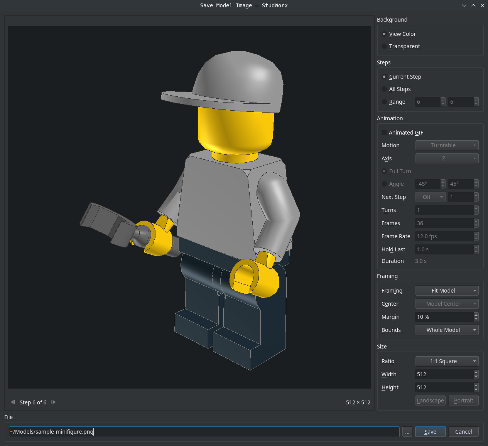
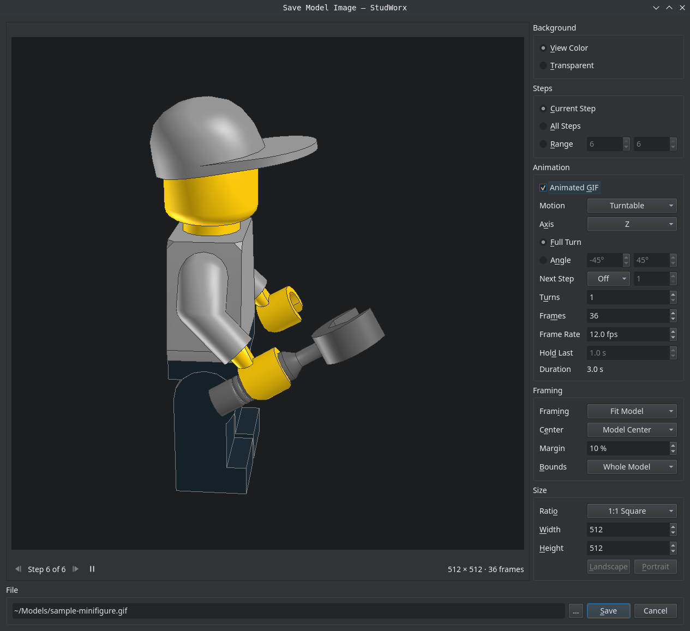
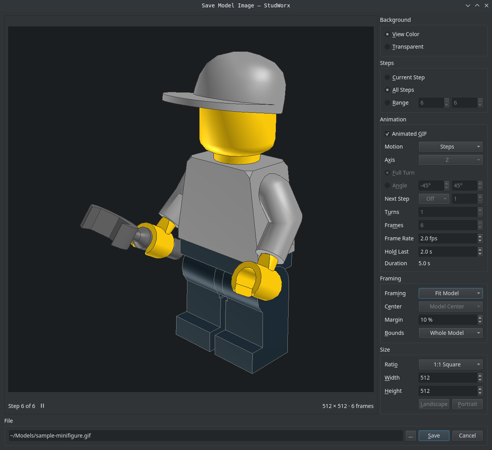
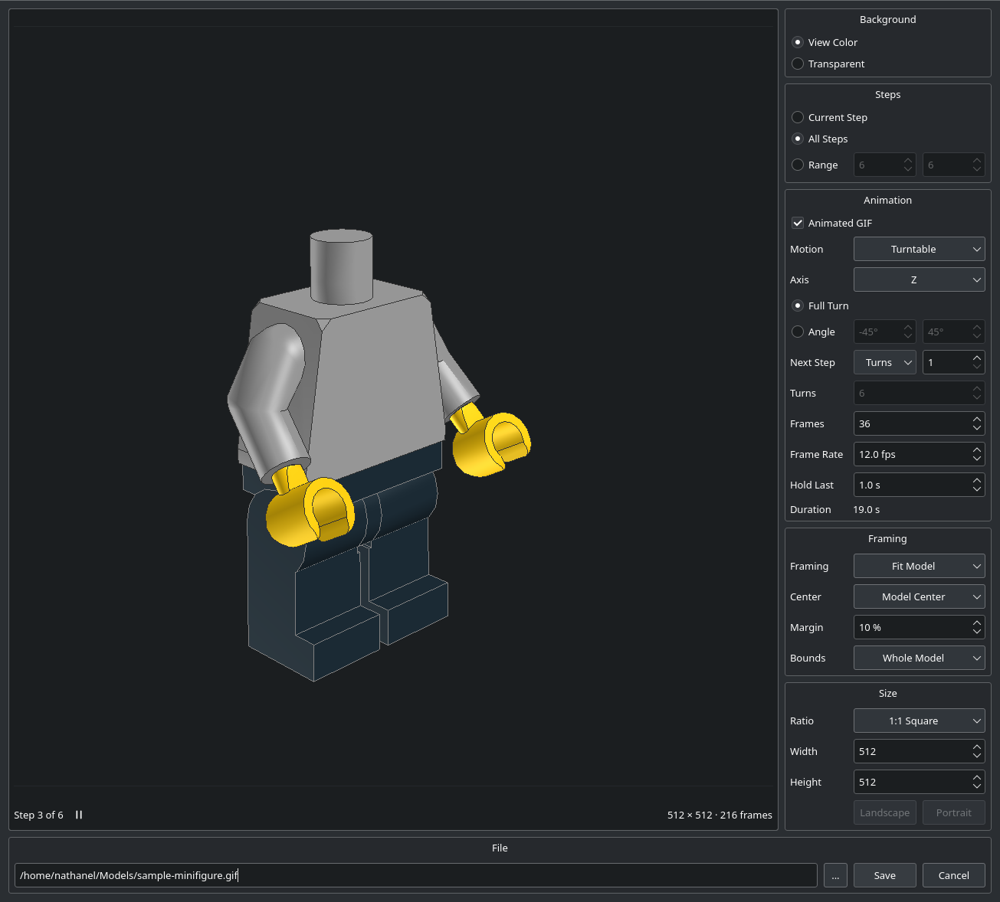

## Rendering

<!-- rendering | details | RENDERING // LIGHTING, SHADING AND RENDERERS -->

The model view draws fast with OpenGL in four lighting styles, and File > Render hands the model to POV-Ray or Blender for photo quality images.

<!-- gallery four -->

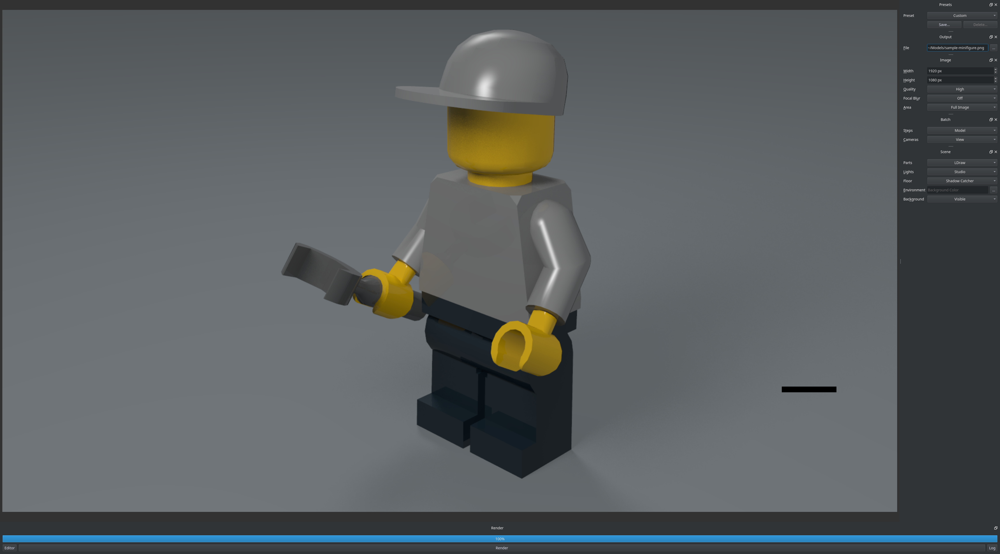
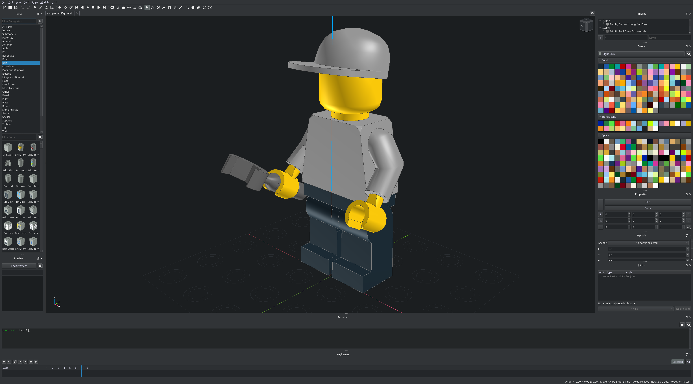

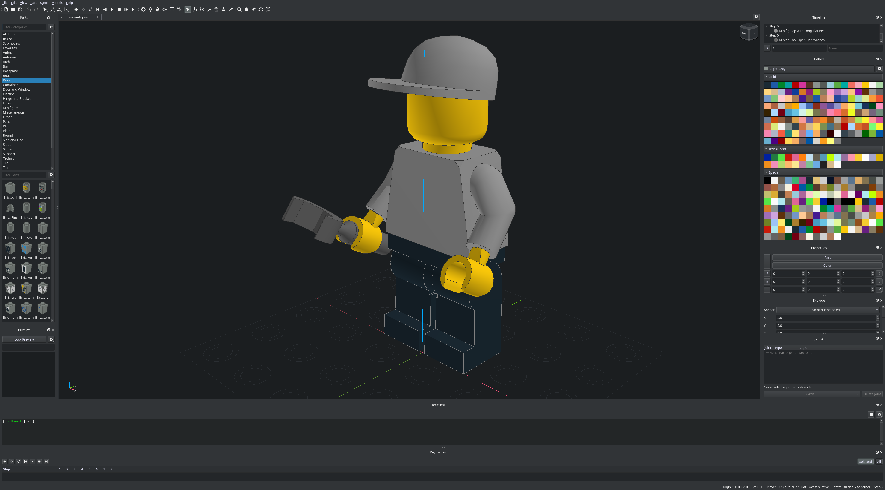
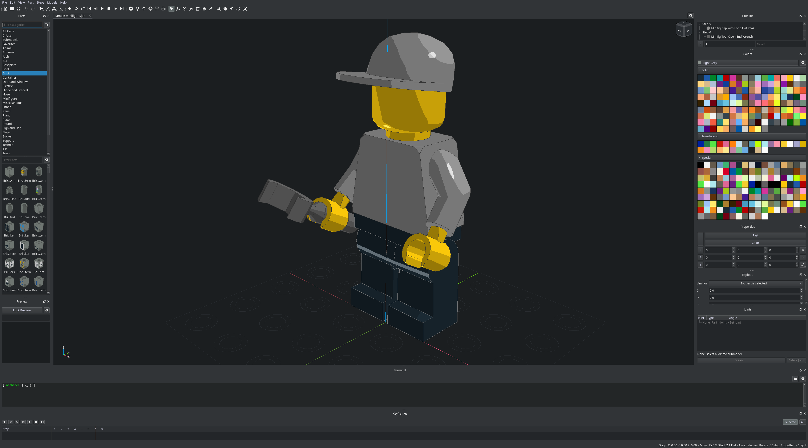
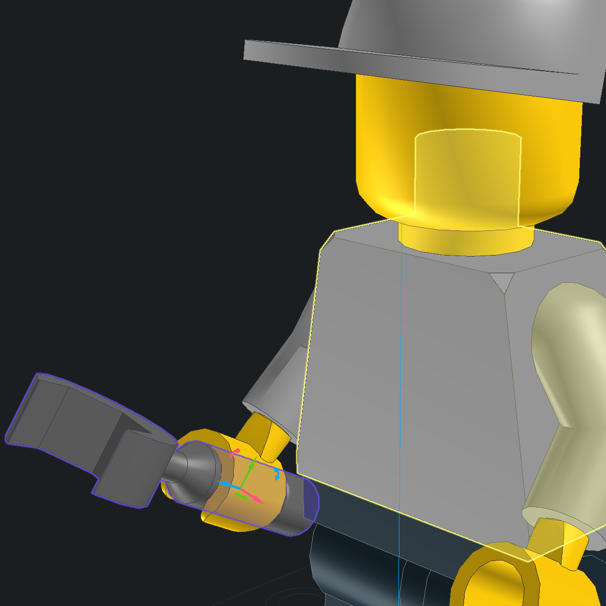


- **POV-Ray.** Found on its own in the PATH, Flatpak or Snap, or bundled on Windows and macOS, and checked for version 3.7. The POV-Ray path in Preferences picks another POV-Ray on every system. LGEO high detail parts are found beside the parts library, downloaded on request or with Download beside the LGEO Library path in Preferences, Update once it is there, with a Parts choice between LDraw and LGEO.
- **Render window.** POV-Ray Render and Blender Render open the Render window, a normal window that stays open beside the model. Choose the output file, follow the progress, and watch the image appear in the preview as it renders. For POV-Ray, Focal Blur keeps the camera target sharp and blurs the parts in front of and behind it, and a Region drawn before the first render shows a faded view of the model to draw on. Hold Ctrl to draw a square region, drag its edges or corners to resize it, drag inside it to move it, and drag outside it to draw a new one. Editor shows the POV-Ray scene file with every part, color and position; tick Render using this configuration instead of the model configuration to render your edits, Reset to write it again from the model, Open to load a scene file, or Save As to keep a copy.
- **Blender.** Render with the bundled Blender LDraw add-ons, with the output, image, scene, parts and editing settings in panels of the render window, or Open in Blender to keep working on the scene there. The Blender executable is set in Preferences.
- **Lighting styles.** Standard Lighting, Studio Lighting, Matte Lighting and Toon Lighting, from the View menu or the command line with --lighting. Standard uses one light with soft highlights, Studio key, fill and rim lights, Matte no highlights, and Toon banded cel shading.
- **Shading.** Wireframe, Flat Shading and Default Lights in View > Shading, and with Edge Lines, Conditional Lines and Mesh Detail Control in the options menu of the model view, Mesh Detail Control drawing distant parts with simpler meshes past the Mesh Level of Detail distance.
- **Mesh level of detail.** Distant parts draw with simpler meshes, from a distance set in Preferences, so large models stay smooth.
- **Studs.** Eight stud styles: Plain Studs, Thin-Line Logo Studs, Outline Logo Studs, Sharp Top Logo Studs, Rounded Top Logo Studs, Flattened Logo Studs, High Contrast Studs and High Contrast Logo Studs.
- **Color configurations.** Colors come from the parts library, the LDraw color configuration or the alternate configuration with more realistic edge line colors for rendering, chosen under Rendering > Colors.
- **Edge colors.** Automate Edge Color computes edge colors from each part color, with edge contrast, saturation and light to dark settings, or set the stud cylinder, edge, black edge and dark edge colors yourself.
- **Separate settings.** The model view, the preview, the parts list and the Minifigure Builder each keep their own rendering settings. Each can follow the model view instead, with Preview Uses Model View Settings, Parts Use Model View Settings and Minifigure Builder Uses Model View Settings, or set its own Wireframe, Flat Shading, Default Lights, Edge Lines, Conditional Lines and line width: Preview Wireframe, Preview Flat Shading, Preview Default Lights, Preview Edge Lines and Preview Conditional Lines, Parts Wireframe, Parts Flat Shading, Parts Default Lights, Parts Edge Lines and Parts Conditional Lines, and Minifigure Builder Wireframe, Minifigure Builder Flat Shading, Minifigure Builder Default Lights, Minifigure Builder Edge Lines and Minifigure Builder Conditional Lines. Preview View Cube and Preview Axis Icon turn the preview overlays on and off, and the parts list has Snap Panel Width to Tiles.
- **Selection highlight.** Outline Highlight or Tint and Edges Highlight, with Increase Outline Width, Decrease Outline Width and an adjustable transparency.
- **Anti-aliasing.** 2x, 4x or 8x samples, and an adjustable line width.

<!-- gallery scroll -->

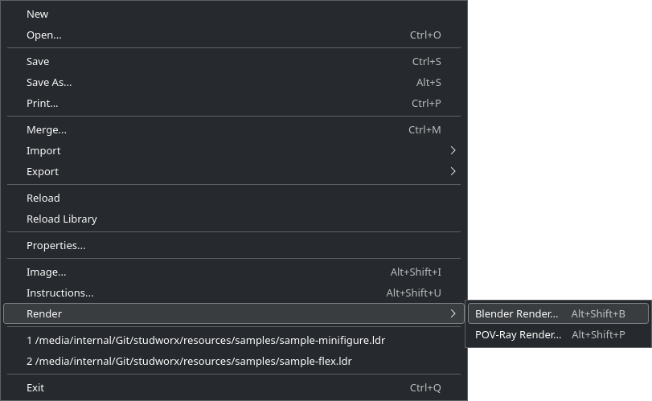
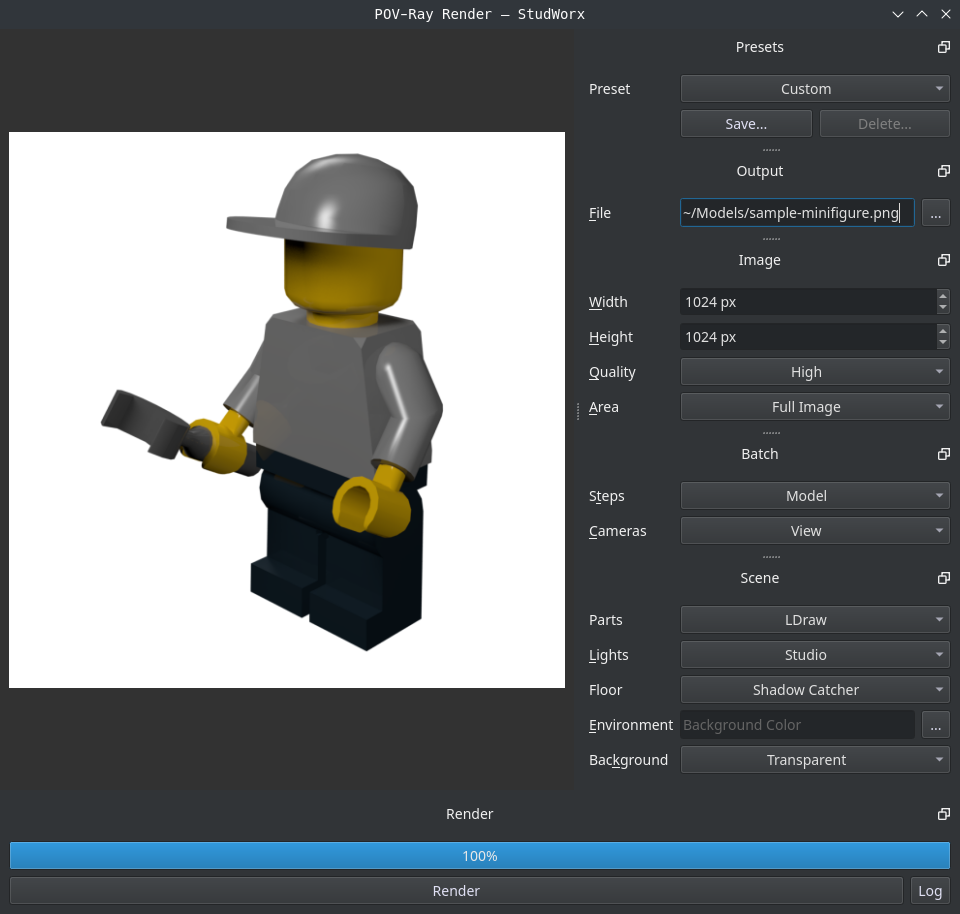
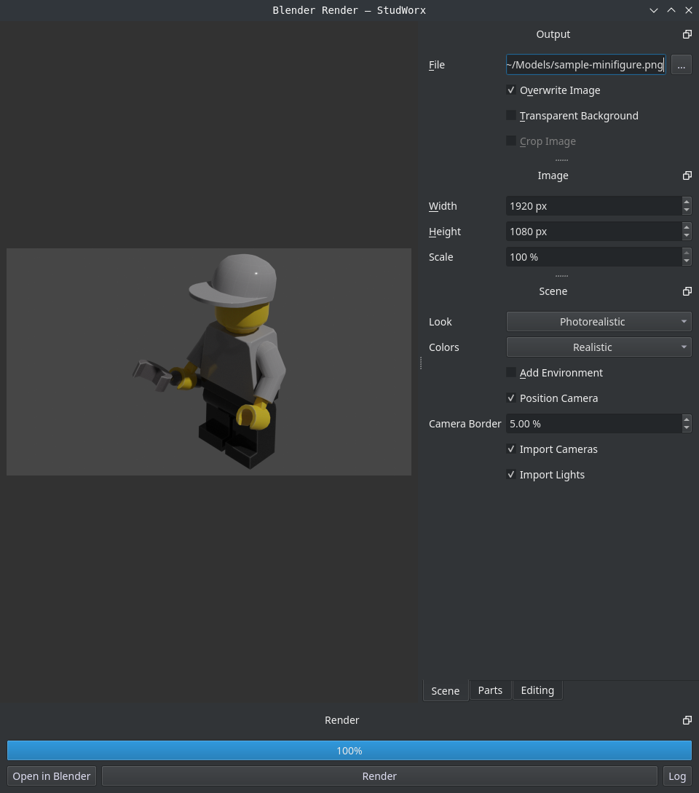
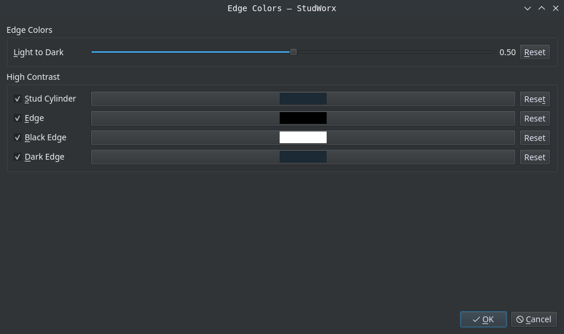


## Modeling

<!-- modeling | color | MODELING // PARTS, SELECTION AND TRANSFORMS -->

Pick a part in the Parts panel, drop it in the model view, then move, rotate, paint and group it. Snapping keeps everything on the LDraw grid, and selection tools find the parts you need in large models.

<!-- gallery three -->

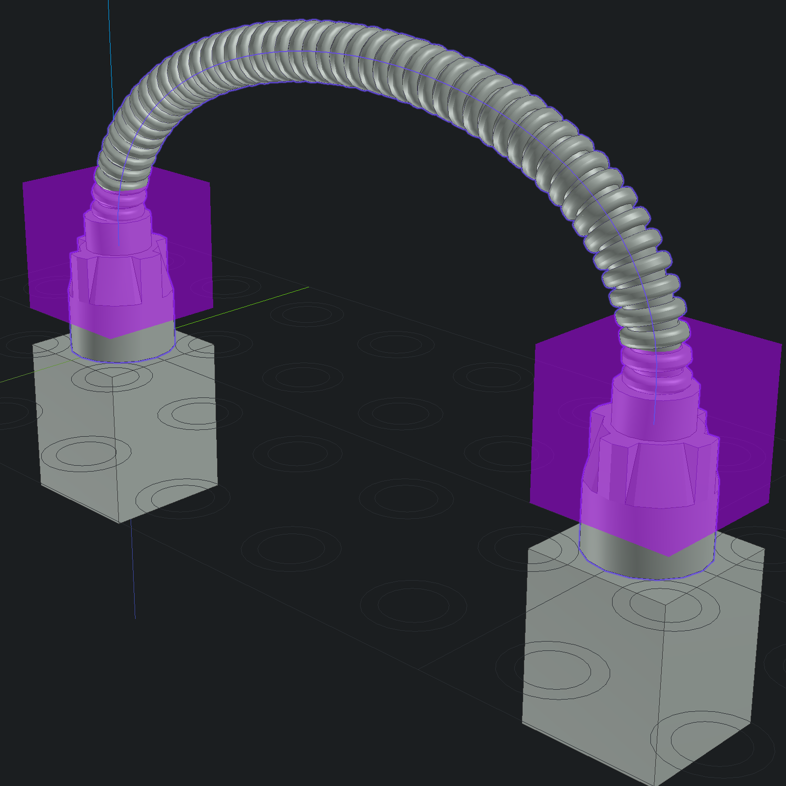
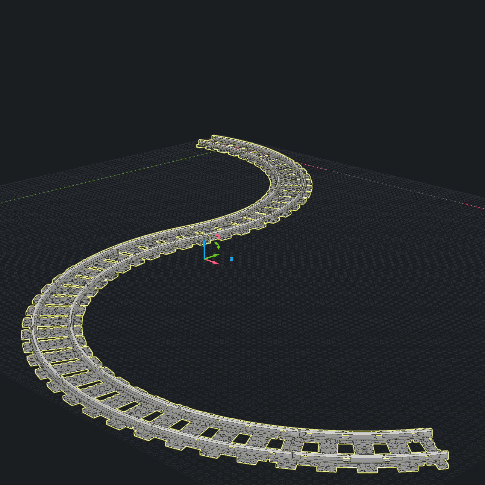


<!-- gallery three -->

[A Flex Path hose follows its end point as it moves, then seats back on its brick](resources/videos/studworx-flex-01.mp4)
[A hose end seated on a newly placed brick, the path bending to reach it](resources/videos/studworx-flex-02.mp4)
[A hose seated on the side of a brick, following it as the bricks move](resources/videos/studworx-flex-03.mp4)

- **Parts.** Insert, Delete, Duplicate, paint, hide and group parts, with Insert Part, Paint Selected, and Insert First Part at Origin to place the first part at the origin.
- **Insert colors.** Insert with the Current Color, the Selected Part Color or the Last Inserted Part Color, from Solid Colors, Translucent Colors or Special Colors, or Lock Parts Color to keep the Parts panel on one color.
- **Snapping.** Move in studs, flats and bricks, rotate in degrees with a custom angle, with relative or absolute transforms and separate or shared rotation.
- **Move snap.** Horizontal steps of 1/20 stud, 1/4 stud, 1 flat, 1/2 stud and 1, 2, 3, 4 or 8 studs, vertical steps of 1/20 stud, 1/4 stud, 1 flat, 1/2 stud, 1 stud and 1, 2, 4 or 8 bricks, or No XY Snap and No Z Snap. Move Snap turns move snapping on and off.
- **Rotation snap.** 1, 5, 15, 22.5, 30, 45, 60, 90 or 180 degrees, a Custom angle, or No Rotation Snap. Camera Snap orbits the view in the same steps. Turns in any step land exactly on square angles, so later moves keep whole coordinates.
- **Transforms.** Relative Transforms move and rotate the selection around the part that has focus, Absolute Transforms in model coordinates. Rotate Separately turns each part around its own pivot, Rotate Together turns the selection as one. Toggle Relative Transforms and Toggle Separate Transforms switch each pair from the keyboard. The Transform toolbar sets Absolute Translation, Relative Translation, Absolute Rotation or Relative Rotation.
- **Keyboard moves.** Move +X, Move -X, Move +Y, Move -Y, Move +Z and Move -Z, and Rotate +X, Rotate -X, Rotate +Y, Rotate -Y, Rotate +Z and Rotate -Z, move and rotate the selection by the snap steps. Fixed Direction Keys keeps the arrow keys on the model axes instead of following the view.
- **Selection.** Select All, Select None, Invert Selection, Select Adjacent Parts, by Name, and by part, color or both. Select Connected Parts follows the connection shapes of the LDCad shadow library.
- **Selection modes.** Single Selection picks one part, Part Selection every part of the same type, Color Selection every part of the same color, and Part and Color Selection both.
- **Select by Name.** A checklist of every object in the model, with All, None and Invert.
- **Part connections.** Use Part Connections in the Editing group of Preferences › General turns connected part selection on and off, with the shadow library folder chosen in Preferences or fetched from GitHub with Download, which turns into Update once the library is in that folder. Snap to Connections in the Movement Snap menu of the toolbar seats a part dragged or inserted over another part on the nearest matching stud, anti stud, hole, axle, bar or clip under the pointer, turned in quarter turns to fit, and Alt moves it freely. Joint on Snap sets a hinge joint where a dragged submodel snaps on a single round axis, like a pin in a hole.
- **Find and Replace.** A bar over the view finds parts by part, color or both, steps through the matches with Find Next and Find Previous or selects them with Find All, and replaces the color or part with Replace Next or Replace All. The part list shows the parts of the model in the colors they are used in, with a flag on parts used in more than one color, and the gear button sets how the part lists are filtered and shown. Replace in Submodels makes Replace All reach every submodel the model uses.
- **Array.** Repeat the selection along one, two or three axes, with a count, an X, Y and Z offset and an X, Y and Z rotation for each.
- **Explode.** The Explode panel, shown from the panel context menu or View > Toolbars, spreads every other visible part, or only the selected ones with each group moving as one part, away from an anchor, the focused part or the first or last selected one, by an X, Y and Z multiple of its distance from 1.0 to 10.0, where 1.0 leaves it in place and 2.0 doubles it, or one value for all three with Uniform following the chosen axis. Explode is greyed out while every spread is 1.0. Each part slides straight out along the stud, pin or socket that holds it, a part without one along the nearest X, Y or Z axis from the part beside it, and with Show Lines a line in the Explode Lines color from Preferences runs through the connection, from the socket on the part it came off to the moved part. Submodels in the spread, and the submodels inside them, flatten into their parts first, so everything spreads, and the flatten and spread are one undo step. Changing a setting spreads the parts again, Collapse or Undo puts the parts and the submodels back, and any other edit only puts the parts back. Save Copy saves the whole exploded project to a separate file named with -exploded before the extension, and the open file is not saved.
- **Flex Path.** Hoses, cables and other flexible parts bend along control points that stop at the part length.
- **Control points.** Insert Control Point and Remove Control Point, Clamp Tangent to hold a point along the path or release it to rotate freely, Align to Tangent once, or turn it along the X Axis, Y Axis or Z Axis. New points can start clamped, and the spread handle shapes the curve.
- **Groups.** Group the selection under a unique name, Ungroup, Add to Group and Remove from Group for the focused part, and Edit Groups in a tree of parts and groups.
- **Hide and show.** Hide Selected or Hide Unselected, then Unhide Selected or Unhide All.
- **Show Earlier and Later.** Show Earlier and Show Later move the selected parts one step earlier or later.
- **Train track.** Rotate Train Track turns a track part to its next connection, clicking the ghost track past an open end picks the part to add there, and Focus Next Connection and Focus Previous Connection choose where the next part joins.
- **Pivot points and keyframes.** Reset Pivot Point puts the pivot back at each part's origin, and Remove Keyframes clears the animation of the selected parts.
- **Lights and cameras.** Lights and cameras are placed in the model and saved with it, see Tools.

<!-- gallery scroll -->

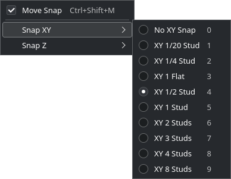

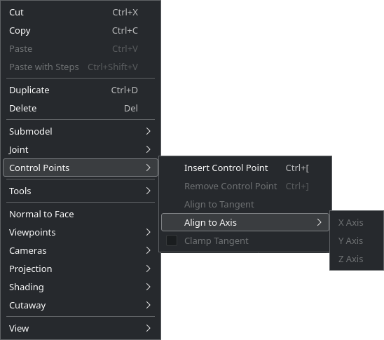
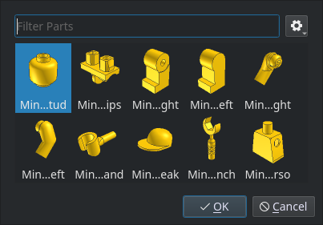
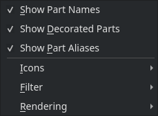
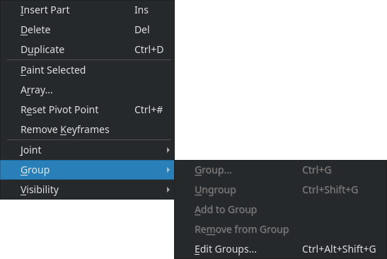
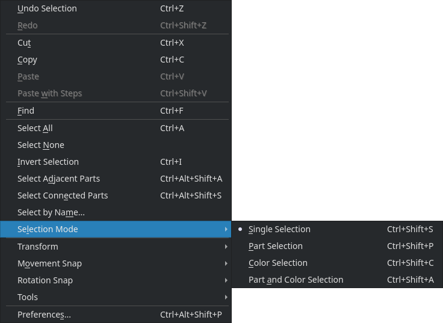
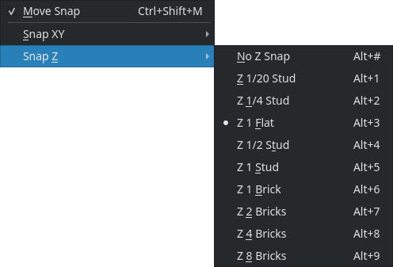
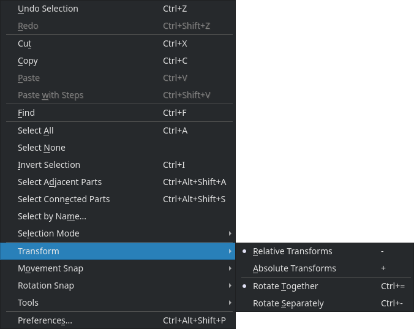


## Tools

<!-- tools | teal | TOOLS // MOUSE, LIGHTS AND CAMERAS -->

The Tools toolbar sets what the mouse does in the model view. Every tool has a keyboard shortcut, and mouse buttons with modifier keys can start any tool for one drag.

<!-- gallery two -->


- **Edit tools.** Insert adds the part chosen in the Parts panel, Select picks objects, with Ctrl or a drag for several, Move and Rotate change the selection, Erase removes what you click, Paint colors a part, and Color Picker takes a part's color.
- **View tools.** Zoom, Pan, Rotate View and Roll change the camera, and Zoom Region zooms into a rectangle you drag.
- **Keyboard and gamepad view.** Zoom In and Zoom Out, and Move Forward, Move Backward, Move Left, Move Right, Move Up and Move Down. In builds with gamepad support, the left stick of a gamepad moves the camera.
- **Lights.** Point Light, Spotlight, Directional Light and Area Light tools place lights in the model, with named properties and units, saved in the model file.
- **Cameras.** The Camera tool places a camera. View > Cameras switches between the first sixteen cameras, or No Camera for the free view.
- **Cancel Action.** Esc cancels the current mouse action, a face or cutaway pick or a cutaway resize, closes the Find and Replace bar, clears the selection, and with nothing selected removes the cutaway.
- **Mouse.** Mouse sensitivity and a shortcut for every tool and view action, recorded in Preferences.

### Joints mode

Give a placed submodel a joint, turn it with the mouse and save the angles as poses of each model, to recall them or play them as an animation.

- **Joints from the shadow library.** SNAP_CYL round shapes become hinges, and SNAP_CLP clips, SNAP_FGR fingers and SNAP_GEN spheres (`bounding=sph`) are read as well. Only SNAP_CYL shapes take part in part connections. Shapes in sub-files of a part, and their placement and mirroring, are followed the same way.
- **Set Joint.** Part > Joint > Set Joint with one submodel selected, or from the right-click menu of the model view, which opens the submodel under the pointer in place and fades everything else in the joint fade color while you pick, then click a connection of the submodel with the Joints tool, which shows the Set Joint pointer and outlines the part under it in red. The click sets the joint and goes back to the Select tool in joint mode on the new joint, with the joint bar over the view and every other submodel faded, opening the holding submodel in place when it sits inside the selected one. A submodel can hold several joints: Set Joint again at another connection adds one, and Set Joint at a joint already there resets it. During the pick only the selected submodel takes clicks, so you can pick through other submodels in front of it. A round shape makes a hinge on its axis, a sphere makes a ball, and a part without shadow data gets a hinge on its origin. The joint goes on the submodel that holds the clicked part, even when that submodel sits inside the selected one, so it shows in the Joints tree under its own model. The Joints panel shows the joint, with an X, Y or Z axis choice, the angle and Delete Joint, which deletes the joint picked in the tree, also with the Delete key. Each joint is saved before the placed submodel, one line per joint, as `0 !SW JOINT PART <HINGE|BALL> <pivot x y z> <axis x y z> <rotation x y z>` in LDraw coordinates, and setting and deleting it is undoable.
- **Joints tool.** Next to Rotate in the Tools toolbar, and the Joint menu is also in the right-click menu of the model view. With one submodel selected, the parts holding its joints are outlined in red, and a right click goes back to the Select tool. Click down into submodels to take the innermost one with a joint and drag; on a submodel with several joints, the joint nearest the click turns. A hinge turns about its axis by the horizontal drag, a ball turns about the screen up and right directions. Rotation Snap applies and one drag is one undo step.
- **Joint Move and Rotate.** Part > Joint > Move Joint or Rotate Joint, also in the right-click menu of the model view, switches to the Move or Rotate tool with the gizmo on the pivot of the selected submodel's picked joint, lined up with a hinge axis in relative mode. The move gizmo gets a red hexagon like a cube outline and the rotate gizmo a red outer ring. The rotate keys and the Rotate tool then turn the joint around its pivot and axis instead of the pivot point, saving the turn as the joint angle; a hinge only turns about its axis. Selecting something else goes back to the pivot point. A bar over the view shows the path to the joint as buttons, as it does for a joint picked in the Joints panel. A joint inside a submodel opens that submodel in place, like Edit Selected Submodel, without a new tab. A submodel button selects that submodel in its parent model, and stays in joint mode on its first joint when it has one; the main model button ends joint mode. The bar's close button clears the selection and returns to the Select tool and to the model you were editing before. Clicking a part outside the opened submodel does the same and selects that part. Use Joint Rotation under General > Editing in the preferences does this whenever a selected submodel has a joint.
- **Joints panel.** View > Toolbars > Joints Panel shows a tree of every model with joints, under it each jointed submodel by name and position (`arm-right.ldr 006`), and under that each of its joints (`Joint 001`) with type and angle. Clicking a joint selects its submodel, in its own model, and makes it the joint the panel and the Move and Rotate gizmos work on. Clicking a model shows its poses in the Poses panel.
- **Poses panel.** View > Toolbars > Poses Panel lists the poses of the model picked in the Joints panel, under a Pose header, each holding that model's joints only. Save stores them under a name, saving a name again replaces it, Recall puts the angles back in one undo step, and Rename and Delete edit the list. Poses are saved in their own model's file as `0 !SW JOINT MODEL "<name>" "<model file>" <part index> <rx ry rz> [joint number]`, one line per joint, the joint number counting from 0 and left out for the first joint. Older project-wide sets and `0 !SW POSE` lines still load, split into the models they belong to.
- **Joints motion.** File > Image > Animated GIF with Motion Joints blends through the poses of the main model in order and back to the first, with Frames between two poses, Frame Rate and Hold Last. Hinges blend their angle, balls blend along the shortest turn.

<!-- gallery scroll -->


## Views

<!-- views | plane | VIEWS // CUBE, CAMERAS, CUTAWAYS AND GRIDS -->

Look at a model from any side, see inside it without changing it, and measure it against the grid.

<!-- gallery three -->


- **View cube.** Chamfered edges and corners: click any of its 6 faces, 12 edges or 8 corners for that view.
- **View cube settings.** Shown in any corner of the view, in Extra Small to Extra Large, with its own face, highlight and text colors, and small full names or large abbreviations (TP, BT, LT, RT, FT, BK) on its faces.
- **Axis icon.** X, Y and Z labels with optional negative axes. The view cube, axis icon and part thumbnails come in Extra Small to Extra Large.
- **Axis icon settings.** Shown in any corner, with or without labels, with negative axes and a cube outline, its color and transparency, and a color for each axis and its negative, set on the Interface page.
- **Preview overlays.** The preview shows its own view cube and axis icon, each turned on and off from its options.
- **Viewpoints.** Front, Back, Top, Bottom, Left, Right and Home, Zoom Extents, Look At and Normal to Face.
- **Projection.** Perspective or orthographic, for the active view or all views at once.
- **Cameras.** A floating camera bar, camera orbit snapping and cameras numbered Camera 001.
- **Cutaways.** Cube, sphere and cylinder cutaways with solid cut surfaces, a shaded cut and resize knobs, pushed in or pulled out by one plate. The cutaway is saved with the model and comes back when the file opens, and the parts themselves are never changed.
- **Cutaway controls.** Grow and Shrink resize the cutaway, Push In and Pull Out move it one plate, Shade Color sets the light shade on the cut faces, and Remove shows the whole model again.
- **Cut edges.** With edge lines on, the cut draws edge lines in each part's edge color where it meets the outer faces, and thinner lines along the corners of the cut faces. Cut Edges in Preferences > Views > Cutaway turns them off.
- **Grids.** A Base Grid with Grid Studs, Grid Lines, vertical XZ Height Grid and YZ Height Grid growing stud by stud and plate by plate around the model with a set Grid Margin and Height Margin, each grid with its own toggle and All Grids to turn them on or off together, and X Axis Line, Y Axis Line and Z Axis Line toggles.
- **Grid settings.** Line spacing, stud and line colors, and Height Grids Behind Model to keep the height grids behind the parts.
- **Idle turntable.** The model turns full screen around the X, Y or Z axis when you leave StudWorx idle. Any input ends it. The idle time and the time for one turn are set in Preferences.

<!-- gallery scroll -->


## Steps

<!-- steps | yellow | STEPS // BUILD ORDER AND TIMELINE -->

Every part belongs to a building step. Steps drive the model view, the instructions and the animated GIFs.

<!-- gallery two -->


- **Steps menu.** Go to the first, previous, next or last step, Insert Before, Insert After or Delete Step, turn on Add Keys (Alt+K), Set Keys (K) or Remove Keys (Shift+K) on the selected objects at the current step, and Play or Pause (Ctrl+K) or Stop (Ctrl+Shift+K) a run through the steps.
- **Timeline.** Shows the step each part is added in and removed in. An empty removal step reads Never. Drag parts between steps or reorder them, and Set Current Step from a step's right-click menu.
- **Move and paste.** Move Selection Here, Move Selection Before and Move Selection After move the selection to the current, previous or next step, Insert Step Before and Insert Step After add a step from the Timeline, and Paste with Steps pastes with its steps.
- **Step views.** MLCad ROTSTEP step views are shown, edited and followed in the Timeline.
- **Keys in the Timeline.** Each step with animation keys lists a Keys row per keyed object naming its keyed properties, and a double click on it selects that object at that step and shows the Keyframes panel.
- **Step view commands.** Step View sets the view rotation of the current step, Remove Step View clears it, and Follow Step Views turns the view to each step's rotation as you change steps.
- **Emphasis.** Highlight New Parts and Fade Previous Steps in the model view and the instructions, with a color for each, and an empty step fades nothing. Fade on Edit tints the rest of the model with the edit fade color while you edit a submodel in place. When it is off, the rest of the model keeps its own colors, slightly translucent. Fade on Joint Set tints every other submodel while you pick a joint, select one in the Joints panel, inside and outside a submodel edited in place, and Fade on Joint Move and Rotate keeps it on while you move or rotate in that mode. Submodel Hover Outline draws a pastel cyan outline around the innermost submodel under the pointer, or the submodel a joint would go on while you pick one, with its color in Preferences. Connection Points marks the connection points of the part under the pointer within a 2x2 stud area while Part Connections is on, in its color from Preferences: a stud sized cylinder standing out of each opening, filled for studs, pins and other male points and hollow for tubes, holes and other female points, while clips, hinge fingers and balls fill their own size, seen through the part. Only the stud and hole points facing the camera show, so studs show from above and tubes from below, and covered ones stay hidden. All seven are under Steps and Highlighting in the view gear menu.
- **Animation keys.** Add Keys records new animation keys for parts, lights and cameras as you change them. The round button at the end of each Properties row is filled when that property has a key at the current step, and clicking it adds or removes that key. The Keyframes panel shows every key on a timeline.
- **Keyframes panel.** View > Toolbars > Keyframes Panel docks a full-width timeline at the bottom or top of the window, one column per step and one row per object, expandable to its properties, with a diamond per key and a line joining the keys of one property. Click an object name to select it in the model view, Ctrl+click to add or remove it from the selection, click its arrow to show its properties, click a step to go to it, double-click a cell to add or remove a key, drag a key to another step or right-click for more. The full and hollow diamonds add or remove the selected objects' keys at the current step, Add Keys makes edits create keys, and rewind, play or pause, stop and forward run through the steps. Selected or All picks which objects are listed. Steps > Set Keys (K), Remove Keys (Shift+K), Add Keys (Alt+K), Play or Pause (Ctrl+K) and Stop (Ctrl+Shift+K) work with the panel hidden too, and the Time toolbar has the same buttons.

<!-- gallery scroll -->


## Panels

<!-- panels | wireframe | PANELS // PARTS, COLORS, PROPERTIES AND MORE -->

Panels dock side by side in any area of the main window, with uniform headers, buttons and text boxes sized from their options button.

- **Parts.** Categories and palettes with a filter. The panel snaps to whole thumbnail tiles and rows, docked or floating, and the tooltip of each part shows its name, ID and weight.
- **Part palettes.** Create, rename, reorder and delete palettes, import them, or build one from an online set inventory.
- **Colors.** Collapsible solid, translucent and special color groups with square color tiles.
- **Properties.** Compact position, rotation and transform rows and a spanning color swatch. Lights and cameras get named rows with units. A round key button ends each animated row, filled when the property has a key at the current step.
- **Minifigure Builder.** Build a minifigure from templates and add several variations to the model.
- **Preview.** Parts and models, floating or docking with a square view, with Keep Last Selection.
- **Explode.** The anchor, the X, Y and Z spread multiples, Uniform, Selected Parts Only and Show Lines, with Explode, Collapse and Save Copy, described under Modeling.
- **Joints.** The picked joint of the selected submodel with its axis, the tree of models, submodels and their joints with Delete Joint for the picked one, a right-click menu to move, rotate or delete a joint, and one on a submodel to edit or delete all its joints.
- **Poses.** The poses of the model picked in the Joints panel with Save, Recall, Rename and Delete.
- **Keyframes.** A full-width timeline of the keys of the selected or all objects per step, with buttons to add or remove keys, Add Keys and playback.
- **Terminal.** An embedded terminal sized to whole rows and columns, with Open Model Folder.
- **Terminal folders.** Follow Model Folder moves the terminal to the folder of each model you open, and Go to Model Folder moves it there once.

<!-- gallery scroll -->


## Instructions

<!-- instructions | blue | INSTRUCTIONS // PAGES READY TO PRINT -->

File > Instructions lays the steps out on pages with a cover, parts lists and a bill of materials. Every page element can be styled and placed, and everything is saved in the model file as !SW INSTRUCTION meta commands.

<!-- gallery three -->


- **Page setup.** Paper and screen presets, metric or imperial units, margins and orientation.
- **Page bar.** First, Previous, Next and Last buttons under the page, Cover and Bill of Materials jumps that grey out while those pages are off, Step Page and Blank Page to insert an empty step or a blank page before the current page, Remove Page for blank pages and pages of empty steps, and a page box to type the page to go to. Every button has its own mnemonic, and the timeline First, Previous, Next and Last shortcuts turn the pages.
- **Pages.** A cover page with the model title and author in their own fonts and colors, a bill of materials under a Parts List title in its own font and color, blank page breaks and the steps per page, set for each page, with page backgrounds of their own for submodel steps and an Apply to All Pages for the page background and thumbnails.
- **Style.** Step dividers, the document font, the model projection, parts list counts, sort order and border, and full page backgrounds.
- **Step images.** Parts new to each step are outlined and the earlier ones fade.
- **Placement.** Place, drag and lock every page element within the page margins, on a snapping page grid. Snap to Anchors snaps the corners, edge centers and center of a dragged element to those of the page area and the other elements, and turning it on turns Snap to Grid off, and the other way around.
- **Elements.** Page numbers, colors, fonts, padding, margin, border, corner radius and background for every page element, plus notices and pointers to emphasize parts and steps.
- **Rulers.** Horizontal and vertical rulers measure the page in the page units, or the document units when they are in use, with the page and its margins shaded and an arrow on each ruler that follows the pointer, filled with its own color and alpha. Show Rulers turns them on and off.
- **Element inspector.** Like the box model of a web browser inspector, Show Element Margins and Show Element Padding fill the margin around and the padding inside every page element, and Show Element Anchors marks its corners, edge centers and center. Each overlay has its own color and alpha in the Colors preferences, and none of them is printed.
- **Editor, Export HTML and Print.** An Editor panel to read and edit the model file text, whose height snaps to whole lines so no line is ever cut off, Export HTML for the instruction pages, and a built-in Print panel.

<!-- gallery scroll -->


## Models

<!-- models | green | MODELS // SUBMODELS AND PROPERTIES -->

Large builds split into submodels that you can edit on their own or in place, inside the model that uses them.

<!-- gallery one -->


- **Properties.** Part IDs, thumbnails and counts, with BrickLink or CSV export, and the size and weight of the model in metric and imperial units. A Weight column gives each part's weight in grams or ounces, chosen with the units box below the table, from the BrickLink part weights, and parts without a known weight show N/A.
- **Submodels.** New Submodel, the Submodels list, Open Selected Submodel, Inline Selected Submodels, Flatten Submodels, which replaces every submodel at all depths with its parts in one undo step, also run from the command line with --flatten, and Move to New Submodel.
- **Submodels list.** Create, rename, duplicate and delete submodels, set the active one, and export them as separate LDraw files.
- **Models menu.** Switch between up to forty models of the file from the Models menu.
- **In-place editing.** Edit a submodel inside its parent. A path bar shows where you are, and its buttons go back to each model.
- **Editing commands.** Edit Selected Submodel enters the selected submodel in place, and End Submodel Editing goes back to its parent.
- **Names.** Consistent default names and numbered duplicates: Submodel 001.ldr, and Car.ldr becomes Car 001.ldr.

<!-- gallery scroll -->


## Preferences

<!-- preferences | grid | PREFERENCES // EVERY SETTING IN ONE PLACE -->

Nine pages with lined up label and control columns, checkboxes included, each label greyed out with its control. Value boxes show their maximum and bring any typed number into range, and every slider shows its value.

- **General.** Reference paths, where the color configurations, minifigure builder settings and BrickLink mapping update from ldraw.org and Rebrickable with one button and bundled copies are used until a file is set, online services, where the Rebrickable API key is kept and Get Key opens its page, a rejected key being cleared so it is asked for again, the author of new models built from a name, email address and comment, such as All rights reserved, joined by the author line splitter and previewed as the author line, and the parts library, Blender, POV-Ray and LGEO locations, where Download fetches the LDCad shadow library and the LGEO library.
- **Startup and files.** Open the most recent file, restore the tab layout, load all parts before showing a model, warn about missing and moved parts, watch for file changes and ask, migrate or keep LeoCAD models when opened.
- **Rendering and Views.** The Display, Studs, Shading, Colors and Steps and Highlighting groups on Rendering, and the Model, View Cube, Axis Icon, Cutaway, Turntable, Axis Lines, Base Grid, Parts, Preview and Minifigure Builder groups on Views.
- **Interface and Instructions.** Every display color on Interface, in groups from the farthest back to the closest, and the default instruction page settings, the rulers and element inspector overlays of the instructions page and the editor options on Instructions.
- **Display colors.** The Interface group with the background, active and inactive view borders, cutaway shade, explode lines, overlays, marquee and text with its halo, then the grid, selected and focused parts, cameras and lights, step highlighting and fading, control points and Flex Paths, every axis and the axis icon outline, the view cube, and the page margins, grid lines, element inspector overlays and ruler pointer of the instructions page. Colors that can be see-through set their alpha in the color picker.
- **Categories.** Part categories turned on and off with a checkbox, edited, imported and exported.
- **Context Menu.** A right click on a part or submodel that is not selected selects it first, so the menu acts on it. The right-click menu of the model view is yours to arrange, in its own tab before Keyboard. Add commands and menus from the list on the left with the arrow, a double click or a drag, reorder them with Up, Down or a drag, and add separators and named submenus, rename or remove entries, or reset to the default layout. Control point commands only show on flexible parts, and empty submenus are left out.
- **Keyboard and Mouse.** Shortcuts recorded by clicking, importable and exportable. Commands that share a shortcut show in red, and assigning a taken shortcut asks before moving it.
- **Shortcut filters.** Filter commands and tools by name or shortcut, give each two shortcuts, and reset them to the defaults.
- **From LeoCAD.** Settings, part palettes and minifigure templates are copied from LeoCAD on the first start.

<!-- gallery scroll -->


## Meta

<!-- meta | edge | META COMMANDS // LDRAW LINE HANDLING -->

Every meta command StudWorx reads, writes or keeps: the official LDraw ones, its own !SW commands, LeoCAD commands it migrates, and the commands of MLCad, LPub, LSynth, L3P, LDLite and Blender.

<!-- include meta -->

## Help

<!-- help | purple | HELP // EVERY "WHAT'S THIS?" ENTRY -->

The same help the app shows from Help > "What's This?", the title bar question mark or F1: @ENTRIES@ entries for every menu command, panel and dialog. Search them, or pick an area.

<!-- include search -->

## Install

<!-- install | orange | INSTALL // DOWNLOAD, BUILD AND RUN -->

Packages are rebuilt from every change and carry the date version of the release. They include their own Qt libraries and the LDraw parts library.

| System | Package |
| --- | --- |
| Debian, Ubuntu | studworx_@VERSION@_amd64.deb / arm64.deb |
| Fedora, Rocky Linux, RHEL, openSUSE | studworx-@VERSION@-x86_64.rpm / aarch64.rpm |
| Any Linux based system | studworx-linux-@VERSION@-x86_64.appimage / aarch64.appimage |
| Windows | studworx-windows-@VERSION@-x64.exe |
| macOS | studworx-macos-@VERSION@-universal.dmg |

[Download the latest release ›](https://github.com/nathaneltitane/studworx/releases/latest)

- **Linux based systems.** The .deb and .rpm packages install to /opt/studworx. The AppImage runs from anywhere after chmod +x. Tested on Debian 12 and 13, Ubuntu 22.04 and 24.04, Rocky Linux 9, Fedora and openSUSE Tumbleweed.
- **macOS.** The disk image is not notarized: on the first start, right click StudWorx and choose Open.
- **Prepare.** To build, install a C++ compiler, Qt 5 (widgets, OpenGL, print support, network, xml and concurrent modules) and zlib development packages, listed below as build requirements. The optional packages add gamepad input, the terminal panel with KDE Frameworks KParts and a KDE Frameworks 5 Konsole, and the file manager thumbnails with KIO.

| System | Build requirements | Optional |
| --- | --- | --- |
| Debian, Ubuntu | g++ make qtbase5-dev qttools5-dev-tools libqt5opengl5-dev libqt5svg5 qt5-image-formats-plugins zlib1g-dev | libqt5gamepad5-dev libkf5parts-dev libkf5kio-dev |
| Fedora, Rocky Linux, RHEL | gcc-c++ make qt5-qtbase-devel qt5-linguist qt5-qtsvg qt5-qtimageformats zlib-devel | qt5-qtgamepad-devel kf5-kparts-devel kf5-kio-devel |
| openSUSE | gcc-c++ make libqt5-qtbase-devel libqt5-linguist libqt5-qtsvg libqt5-qtimageformats zlib-devel | kparts-devel kio-devel |
| Arch Linux | base-devel qt5-base qt5-tools qt5-svg qt5-imageformats zlib | qt5-gamepad kparts5 kio5 |

```
git clone https://github.com/nathaneltitane/studworx
cd studworx
qmake studworx.pro
make -j"$(nproc)"
```

Or build and install with the thumbnail plugin, file types and associations registered. The prefix defaults to /usr/local, and ~/.local installs without superuser rights. Run it again after git pull to update.

```
git clone https://github.com/nathaneltitane/studworx
studworx/tools/studworx-install [prefix] [build directory]
```

- **Run.** Start StudWorx and let it download the LDraw parts library on the first start, or point Preferences to one or set LDRAW_DIRECTORY or LDRAWDIR. Press Download beside Preferences > Part Connections, or set it to an LDCad shadow library folder, to select connected parts.
- **Package.** Run resources/packaging/deb/deb.sh, resources/packaging/rpm/rpm.sh or resources/packaging/appimage/appimage.sh, with an optional build directory.

## News

<!-- news | fuschia | NEWS // LATEST CHANGES -->

The latest release notices from the StudWorx repository.

<!-- include notice -->

[Read every notice ›](https://github.com/nathaneltitane/studworx/blob/main/NOTICE.md)
